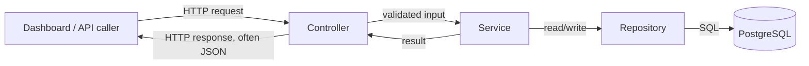
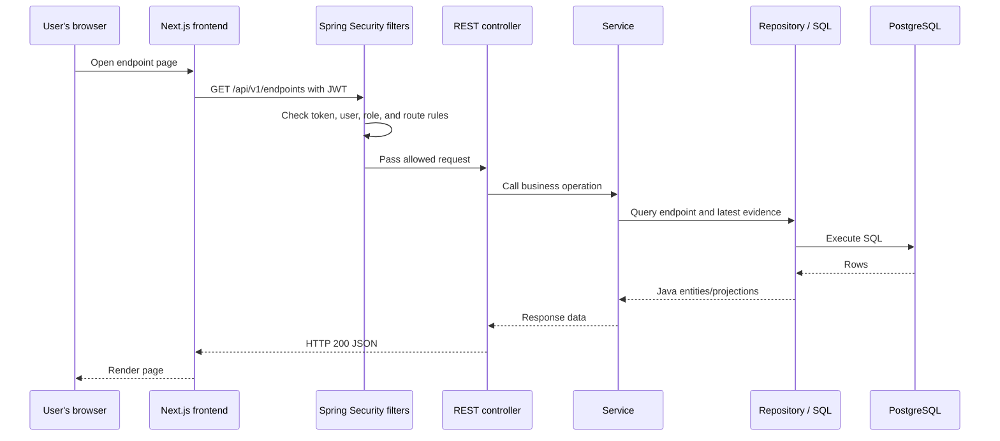
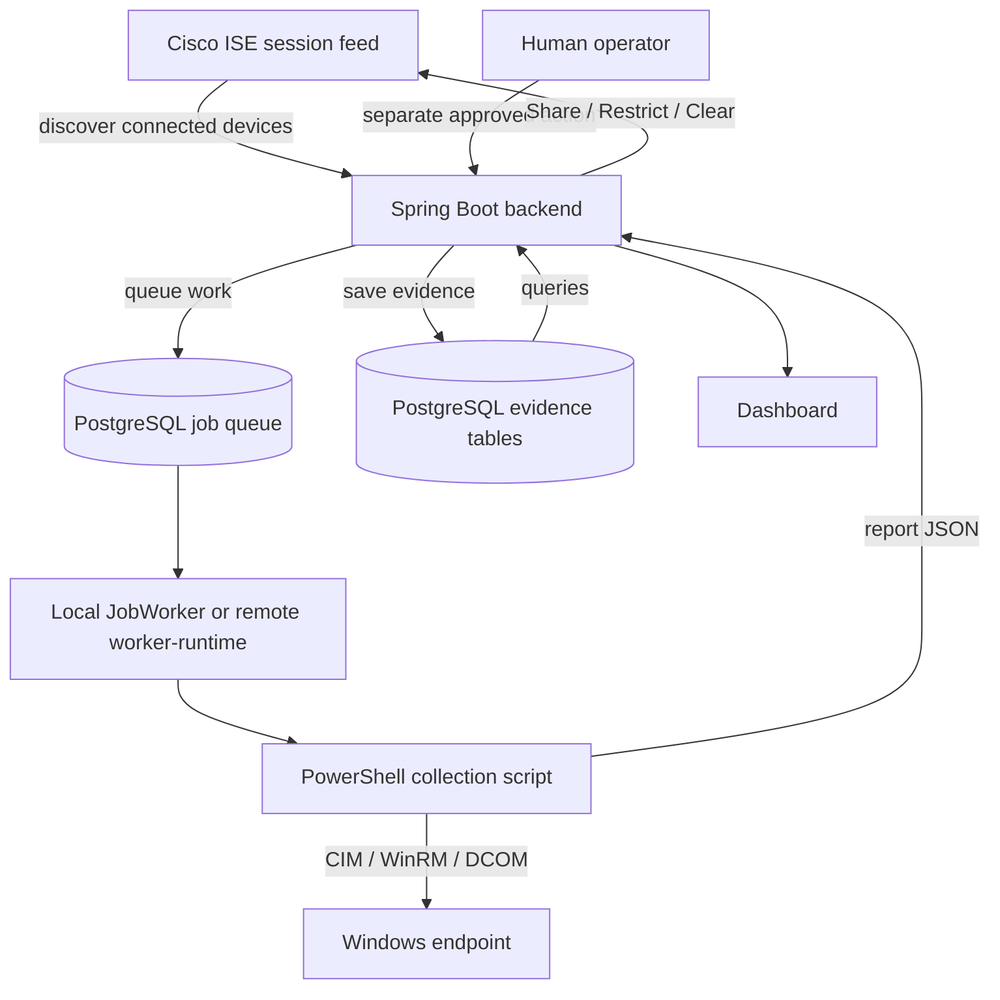
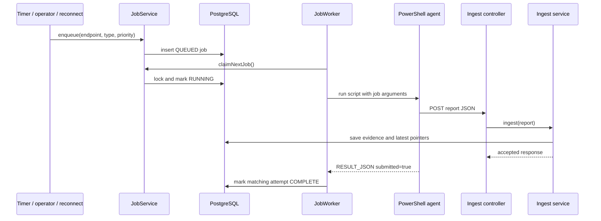
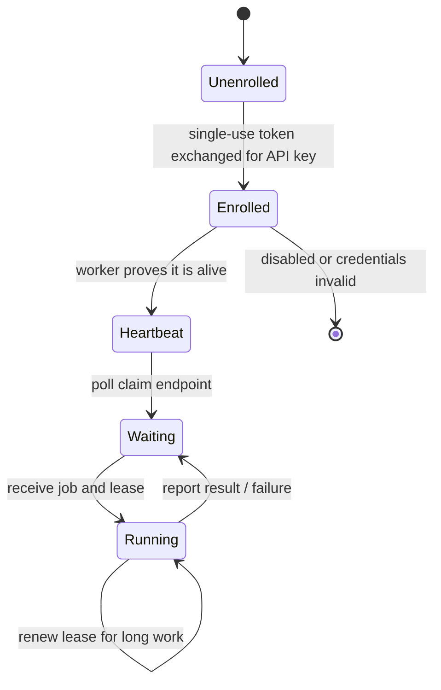
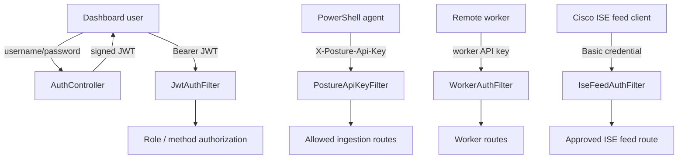
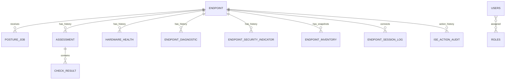

# Backend explained for beginners

This guide explains how this repository's backend works in plain language. It is written for someone who can read files but is new to backend terms such as controller, service, repository, entity, transaction, job queue, and authentication.

The backend is the Java application in `backend/`. `worker-runtime/` is a separate Java program that can connect to the backend as a remote worker. `scripts/` contains the PowerShell collectors that actually inspect Windows endpoints. `frontend/` is the dashboard that calls the backend API.

> The code is the source of truth. For the broader system reference, see [PROJECT_COMPLETE_GUIDE.md](PROJECT_COMPLETE_GUIDE.md). This guide focuses on understanding what calls what, and why.

## 1. The simplest picture

Think of the backend as a reception desk plus a filing room and a task coordinator:

- **Controllers** are the reception desk. They accept HTTP requests and return HTTP responses.
- **Services** do the work and apply the rules.
- **Repositories** read and write database records.
- **Entities** are Java representations of database rows.
- **DTOs** are safe, purpose-built shapes of data sent over HTTP.
- **Schedulers and workers** do work in the background without a person clicking a button.
- **PostgreSQL** stores users, endpoints, jobs, and collected evidence.



The project is a **modular monolith**: many feature packages, but one Spring Boot backend process and one database. It is not a collection of separate microservices. The remote worker is an optional separate process.

## 2. What happens when an HTTP request arrives

Suppose the dashboard asks for an endpoint page. The rough path is:



Spring annotations provide much of the plumbing:

| Annotation / term | Beginner meaning |
|---|---|
| `@SpringBootApplication` | Starts Spring and scans the application's packages for components. |
| `@RestController` | A class whose methods handle web requests and usually return JSON. |
| `@RequestMapping`, `@GetMapping`, `@PostMapping` | Connect a URL and HTTP verb to a Java method. |
| `@Service` | Marks a class that contains application/business work for Spring to manage. |
| `@Repository` | Marks database access code; Spring Data can generate implementations. |
| `@Entity` | Maps a Java object to a database table. |
| `@Transactional` | Run a group of database operations as one unit: all commit together or roll back together. |
| `@Valid` | Ask Jakarta validation to check request fields before the method proceeds. |
| `@PreAuthorize` | Check a user's role/authority before allowing a method to run. |
| `@Scheduled` | Run a method on a timer or cron schedule. |
| Constructor injection | Spring supplies a class's dependencies through its constructor. This makes dependencies visible. |

### HTTP words you will see

- **GET** reads information.
- **POST** submits information or requests an operation.
- **Path variable** is a value embedded in the URL, such as `/endpoints/{id}`.
- **Request body** is JSON sent by the caller.
- **Response body** is JSON returned by the backend.
- **Status code** tells the caller the broad outcome: `200` success, `201` created, `400` bad input, `401` not authenticated, `403` not allowed, `404` missing, `409` state conflict, `502` external ISE failure.

## 3. The system's job in one diagram

The platform observes endpoints and stores evidence. Cisco ISE remains the network enforcement authority. A posture result does not automatically cause a restriction.



## 4. The important parts of the repository

| Location | What it is for |
|---|---|
| `backend/src/main/java/com/endpointposture/EndpointPostureApplication.java` | Application entry point: boots Spring. |
| `backend/src/main/java/...` | Backend code, grouped by business feature. |
| `backend/src/main/resources/application.yml` | Default settings: server, database, security, jobs, and integrations. |
| `backend/src/main/resources/db/migration/` | Ordered SQL scripts that create/update the schema through Flyway. |
| `backend/src/test/java/` | Tests that demonstrate expected behavior for classes and flows. |
| `worker-runtime/src/main/java/` | Standalone Java worker: enrolls, claims jobs, runs PowerShell, and returns results. |
| `scripts/*_agent.ps1` | Programs that collect posture, hardware, diagnostics, or security indicator data. |

The Spring Boot `main` method is intentionally tiny: `SpringApplication.run(...)` starts the web server, builds the Spring application context, creates configured components, and starts configured schedulers.

## 5. Controllers, services, repositories, entities, and DTOs

These are layers of responsibility, not separate servers.

### Controller: translate HTTP into Java calls

A controller knows about URLs, request/response formats, and HTTP status codes. It should generally be thin. Example: `PostureIngestController` accepts an agent report and delegates it to `PostureIngestService`.

### Service: apply the rules

A service knows what the application should do. It checks conditions, calculates statuses/scores, coordinates multiple repositories, and often defines a transaction. Example: `PostureIngestService.ingest(...)` normalizes and stores a report.

### Repository: talk to the database

A repository provides database operations. Spring Data derives some SQL from method names; repositories can also contain explicit SQL for performance or PostgreSQL-specific behavior. Example: `PostureJobRepository` handles queued job records.

### Entity: represent a persisted row

An entity such as `Endpoint`, `Assessment`, or `PostureJob` maps Java fields to a table's columns. Entities can reference related entities, for example a job belongs to an endpoint.

### DTO: define the API contract

A DTO is data shaped for one API purpose. A request DTO describes accepted input; a response DTO describes output. DTOs keep internal persistence details from becoming the API by accident and allow request validation.

Typical path:

```text
HTTP JSON -> Request DTO -> Controller -> Service -> Repository -> Entity/database
HTTP JSON <- Response DTO <- Controller <- Service <- Repository <- Entity/database
```

## 6. The key end-to-end flow: collect a posture report

### Step A: a job is created

A job can be requested by an operator, by endpoint discovery/reconnection, or by a periodic recheck. `JobService.enqueue(...)` creates a `PostureJob` row with a job type, endpoint, priority, status, and attempt tracking.

The queue lives in PostgreSQL, so it survives a process restart. `JobType` says what work to run (`POSTURE_CHECK`, `HARDWARE_CHECK`, `DIAGNOSTIC_CHECK`, or `SECURITY_CHECK`). `JobStatus` tracks its lifecycle (`QUEUED`, `RUNNING`, `COMPLETE`, `FAILED`).

### Step B: one worker claims it

The local `JobWorkerPool` repeatedly calls `JobWorker.runOnce()`. The worker asks `JobService.claimNextJob()` for one eligible job. SQL locking prevents two workers from claiming the same row at the same time. With remote workers enabled, `WorkerController` and `WorkerJobService` use worker identity, shard assignment, attempt number, and a time-limited lease to claim safely.

### Step C: build and run a job specification

`JobSpecFactory.build(...)` turns a stored job into a typed specification. `PostureSpec`, `HardwareSpec`, `DiagnosticSpec`, and `SecuritySpec` contain the inputs needed for the relevant agent. `AgentArgs.of(...)` turns those inputs into command-line arguments.

The local runner (`LocalProcessAgentRunner`) starts PowerShell. The separate `worker-runtime` has `PowerShellJobHandler` and `PowerShellExecutor` for the same job execution role on a remote worker host. API keys are supplied through the process environment, not as visible command-line arguments.

### Step D: the agent inspects and reports

The PowerShell script queries the endpoint and POSTs JSON to a dedicated ingestion route. That ingestion call has agent authentication. The script also prints a `RESULT_JSON:` status line so the job runner can tell whether submission succeeded.

### Step E: the backend saves evidence and closes the job

For posture, `PostureIngestService.ingest(...)` upserts the endpoint identity, computes an overall status from reported checks, saves an `Assessment`, saves individual `CheckResult` rows, updates endpoint latest-result pointers, and saves an inventory snapshot. A transaction keeps these related writes consistent.

If a job result says it was submitted, `JobOutcomeService.complete(...)` marks the matching attempt complete. If it failed, `JobOutcomeService.fail(...)` records failure evidence and applies retry/backoff rules. Attempt fencing ensures an old worker response cannot overwrite a newer retry.



### When a collection fails

Failure can happen before the script starts (missing script/config), during execution (timeout/process error), or during report submission. The job system records a useful failure reason and, where appropriate, writes an explicit failed/error evidence record. Retry limits prevent endless attempts against a device that cannot be reached. `StaleJobRecoveryScheduler` looks for jobs left running after their timeout and recovers them.

## 7. Local and remote worker execution

There are two execution approaches represented in the code:

1. **Local process mode:** backend's `JobWorkerPool` calls PowerShell on the backend host using `LocalProcessAgentRunner`.
2. **Remote worker mode:** the standalone `worker-runtime` enrolls with the API, authenticates with its worker key, claims a job for its shard, runs PowerShell on its host, then reports completion/failure.

Remote worker lifecycle:



In `worker-runtime`, `WorkerMain` is the entry point; `WorkerBootstrap` loads settings and constructs clients/handlers; `WorkerLifecycle` coordinates startup, heartbeat, claiming, and shutdown. `WorkerApiClient` performs HTTP requests. `JobSpecParser` validates the job received from the API. `PowerShellJobHandler` runs it. `ResultDispatcher` sends the completed result, while `SqliteJobResultHandoff` persists unsent results locally so a temporary network outage does not lose them. `CredentialStore` and `DpapiSecretProtector` store the worker secret protected for the Windows account.

On the backend, `WorkerController` exposes enrollment, heartbeat, claim, renew, complete, and fail routes. `WorkerRegistryService` validates/enrolls workers. `WorkerAuthFilter` identifies workers from credentials. `WorkerJobService` performs lease and attempt checks. These worker routes are distinct from the user JWT and agent API-key routes.

## 8. How major feature areas fit together

Every package follows roughly the same vocabulary: controller (HTTP), service (rules), repository (database), entity (stored data), DTO (API shape). Not every package has all five; read the classes that exist rather than expecting a fixed template.

| Package | What it does | Useful starting classes/methods |
|---|---|---|
| `security` | Login, JWT identity, roles, API key access, rate limits, security headers | `AuthController` login endpoint; `JwtService` creates/validates JWTs; `JwtAuthFilter` authenticates requests; `SecurityConfig` defines route/security rules; `UserService` user operations. |
| `endpoint` | Endpoint identity and fleet lookups | `EndpointController`; `EndpointService`; `EndpointQueryService`; `EndpointRepository`. MAC address is the stable device identity key. |
| `job` | Queue, dispatch, retries, scheduled rechecks and stale-job recovery | `JobService.enqueue/claimNextJob/enqueueIfDue`; `JobWorker.runOnce/dispatch/handleResult`; `JobSpecFactory.build`; `JobOutcomeService`; `JobWorkerPool`; `RecheckScheduler`. |
| `worker` | Remote worker enrollment, authentication, leases, job results | `WorkerController`; `WorkerRegistryService`; `WorkerJobService.claim/renew/complete/fail`; `WorkerAuthFilter`; `WorkerResultController` and `WorkerResultService`. |
| `posture` | Posture report ingestion and assessment queries | `PostureIngestController`; `PostureIngestService.ingest`; `AssessmentService`; `PostureQueryController`; assessment/check result entities and repositories. |
| `hardware` | Hardware report ingestion, component scoring and fleet summaries | `HardwareIngestController`; `HardwareIngestService`; `HardwareHealthService.recordReport`; component scorer classes such as `CpuScorer`; query controllers. |
| `diagnostic` | Network experience probe reports and scores | `DiagnosticIngestController`; `DiagnosticService.ingest`; `DiagnosticScorer`; `DiagnosticQueryController`. |
| `indicator` | Analyze connection snapshots for possible security signals | `SecurityIndicatorIngestController`; `SecurityIndicatorService.ingest`; `SecurityIndicatorAnalyzer`; query controller. A finding is evidence for review, not an automatic action. |
| `session` | Poll ISE active sessions and track connect/disconnect history | `IseSessionWatcher` scheduled tick; `IseSessionClient`; `SessionBatchWriter`; session log query controller. A failed ISE poll does not mean all devices disconnected. |
| `ise` | Operator-triggered Share, Restrict, and Clear operations | `IseActionController`; `IseActionService`; `IseTransport` interface; `ErsIseTransport` real adapter; `IseActionStateService`. This is deliberately separate from ingestion. |
| `isefeed` | Give Cisco ISE a controlled feed of approved posture data | `IseFeedController`; `IseFeedService`; `SharingRuleService`; feed audit records. |
| `dashboard` | Aggregate backend data for dashboard cards and trends | `DashboardController`; `DashboardService`; `DashboardRepository`; `TrendRollupScheduler`. |
| `inventory` | Store/query collected application and endpoint inventory | `InventoryController`; `InventoryQueryService`; `InventoryRetentionService`. |
| `policy` | Store application requirements/block lists used by posture jobs | `PolicyController`; `PolicyService`; policy/rule repositories. Job spec creation includes the active policy for the agent. |
| `warranty` | Parse uploaded warranty CSVs and associate coverage data | `WarrantyController`; `WarrantyService`; `WarrantyRecordRepository`. |
| `audit` | Query records of operator ISE actions | `AuditQueryController`; `IseActionAuditRepository`. |
| `retention` | Delete old evidence in bounded batches while protecting latest pointers | `EvidenceRetentionScheduler`; `EvidenceRetentionService`. |
| `system` | Report API/database/ISE/queue operational health | `SystemHealthController`; `SystemHealthService`; health DTOs. |
| `sim` | Simulated identity, sessions, reporting and agent execution for development/load simulation | `SimulatedAgentRunner`, `SimulatedIseSessionClient`, `SimReporter`, `SimIdentity`. |

## 9. Important behavior rules

### Endpoint connection and endpoint posture are different facts

`endpoint.connected` means ISE currently reports an active connection. The latest assessment means the last time a check ran. An endpoint can be disconnected and still have a historical compliant assessment. The dashboard must not confuse these.

### Evidence collection cannot enforce a device

Ingestion controllers/services record data. ISE actions live in their own controller/service/transport path and require an authorized human role. The separation prevents a report from silently triggering network enforcement.

### A failed poll is not an empty poll

`IseSessionWatcher` compares successful polls over time. If the ISE connection fails, it preserves known device state rather than interpreting the failure as every endpoint having disappeared.

### Current pointers are shortcuts to latest evidence

The endpoint row keeps references such as latest assessment/hardware IDs. This makes common dashboard reads faster. Older evidence rows remain historical records subject to retention rules.

### Why some code uses SQL instead of entity-by-entity loops

For large fleets, set-based PostgreSQL statements and batch writes update many endpoints in fewer database round trips. `SessionBatchWriter`, scheduled rechecks, and dashboard queries use this style where scale matters.

## 10. Authentication and authorization

Different callers have different credentials:



- **Authentication** answers “who is calling?”
- **Authorization** answers “may this caller do this?”
- `Role` and `@PreAuthorize` restrict privileged operations. The frontend may hide buttons, but server-side checks are the real security boundary.
- `AuthController` handles login. `JwtService` signs/verifies tokens. `JwtAuthFilter` reads bearer tokens. `SecurityConfig` assembles the filter chain and route rules.
- `PostureApiKeyFilter` grants agents access to the narrow ingestion use case; it is not a dashboard login.
- `WorkerAuthFilter` produces a `WorkerPrincipal` from a worker credential. Worker jobs also use lease/attempt ownership checks.
- `LoginAttemptService` and `LoginRateLimiter` reduce brute-force attempts. `SecurityHeadersFilter` adds browser security headers.

## 11. Database and schema changes

Flyway runs numbered SQL scripts in `backend/src/main/resources/db/migration/` (for example `V1__...sql`, `V2__...sql`). They create and evolve tables and indexes in order. Do not assume Hibernate invents the schema: configuration uses database migrations and validates mappings against the schema.

Conceptually the main relationships look like this:



This is a conceptual map, not a full column-by-column schema. To see exact columns/constraints, open the matching migration SQL and entity class. `PostureJob` history is operational state; assessments, hardware, diagnostics, and indicators are collected evidence.

## 12. Background tasks

Background methods are usually marked with `@Scheduled` and configured with fixed delays or cron expressions. They do not require an HTTP caller.

| Background component | Purpose |
|---|---|
| `IseSessionWatcher` | Polls ISE sessions and updates endpoint connection state. |
| `JobWorkerPool` | Looks for queued local jobs and executes them concurrently. |
| `RecheckScheduler` | Queues due posture and hardware checks, with limits/backoff. |
| `StaleJobRecoveryScheduler` | Repairs jobs stuck in `RUNNING`. |
| `TrendRollupScheduler` | Refreshes summary data used for trends. |
| `JobRetentionScheduler` | Removes old finished job queue records. |
| Inventory/evidence retention schedulers | Prune or compact old records while retaining key/latest data. |

Schedulers create work or maintain state; they do not replace the HTTP API. Each task's concrete cadence and settings are in `application.yml` and profile-specific configuration.

## 13. Reading a class without getting lost

Use this order:

1. Find the controller method and note its HTTP method, route, request, and response.
2. Follow the service call it makes. This is usually where the business rule lives.
3. Follow repository calls to see what is read or written.
4. Open the entity and Flyway migration to understand stored fields.
5. Open DTOs to understand the external data shape.
6. Search for other callers of the service to find scheduler/worker paths.
7. Read the tests for examples of normal and edge cases.

Useful words in method names:

- `get` / `find`: read something.
- `save` / `update`: persist changes.
- `enqueue`: add work to a queue.
- `claim`: reserve queued work for one worker.
- `ingest`: accept and store a collector's report.
- `record`: add an event or evidence row.
- `build`: assemble an object from other inputs.
- `map`: convert between representations.
- `validate`: reject data that violates a rule.
- `complete` / `fail`: close a job attempt with an outcome.

Method names are clues, not guarantees; inspect the implementation and tests for the exact contract.

## 14. A practical learning route through this codebase

Read one vertical slice rather than trying to memorize every package:

1. `EndpointPostureApplication` — how the application starts.
2. `SecurityConfig`, `AuthController`, `JwtService` — how a dashboard user gets authenticated.
3. `EndpointController` -> `EndpointService`/`EndpointQueryService` -> `EndpointRepository` — a read request.
4. `JobController` -> `JobService` -> `JobWorker` -> `JobSpecFactory` — how work is requested and run.
5. `scripts/posture_agent.ps1` -> `PostureIngestController` -> `PostureIngestService` -> `Assessment` and `CheckResult` — how evidence returns and is stored.
6. `IseSessionWatcher` -> `SessionBatchWriter` — how active devices are discovered.
7. `IseActionController` -> `IseActionService` -> `ErsIseTransport` — how an operator action reaches ISE.
8. `WorkerMain` and `WorkerLifecycle` — how remote worker execution differs from local process mode.

At each step, ask: **Who calls this? What input does it receive? What rule does it apply? What does it read/write? What does it return?** That question set works for nearly every class in the backend.

## 15. Short glossary

| Word | Plain meaning |
|---|---|
| API | A set of URLs and rules that let programs communicate. |
| Backend | Server-side program that handles requests, rules, and data. |
| JSON | A common text format for sending structured data. |
| Database row | One stored record, such as one endpoint or one assessment. |
| Primary key / ID | A unique label for one stored row. |
| Foreign key | A database link from one row to another. |
| Index | A lookup structure that makes certain database searches faster. |
| Transaction | A group of database writes treated as one all-or-nothing operation. |
| Queue | Stored work waiting for a worker to process it. |
| Retry / backoff | Try failed work again, but wait to avoid repeatedly hammering a failing endpoint. |
| Lease | A time-limited reservation that says which worker currently owns a job. |
| Shard | A grouping that directs certain jobs to a subset of workers. |
| Evidence | A collected observation, such as an assessment or hardware report. |
| Adapter | Code that translates the application's interface into an external system's protocol; `ErsIseTransport` is an example. |
| Idempotent | Safe to repeat without accidentally creating duplicate effects. |
| RBAC | Role-based access control: access is granted according to a user's role. |

## 16. Where to look next

- Whole-system reference: [PROJECT_COMPLETE_GUIDE.md](PROJECT_COMPLETE_GUIDE.md)
- System architecture: [PROJECT_ARCHITECTURE.md](PROJECT_ARCHITECTURE.md)
- Database guide: [DATABASE_BEGINNER_GUIDE.md](DATABASE_BEGINNER_GUIDE.md)
- Frontend guide: [FRONTEND_BEGINNER_GUIDE.md](FRONTEND_BEGINNER_GUIDE.md)
- Backend decisions and status: [DECISIONS.md](DECISIONS.md), [FEATURE_ROADMAP.md](FEATURE_ROADMAP.md)
- Worker program details: [../worker-runtime/README.md](../worker-runtime/README.md)
- How to start the project: [../README.md](../README.md)
- Spring Boot methods: start from `backend/src/main/java/com/endpointposture/` and follow controller -> service -> repository.

