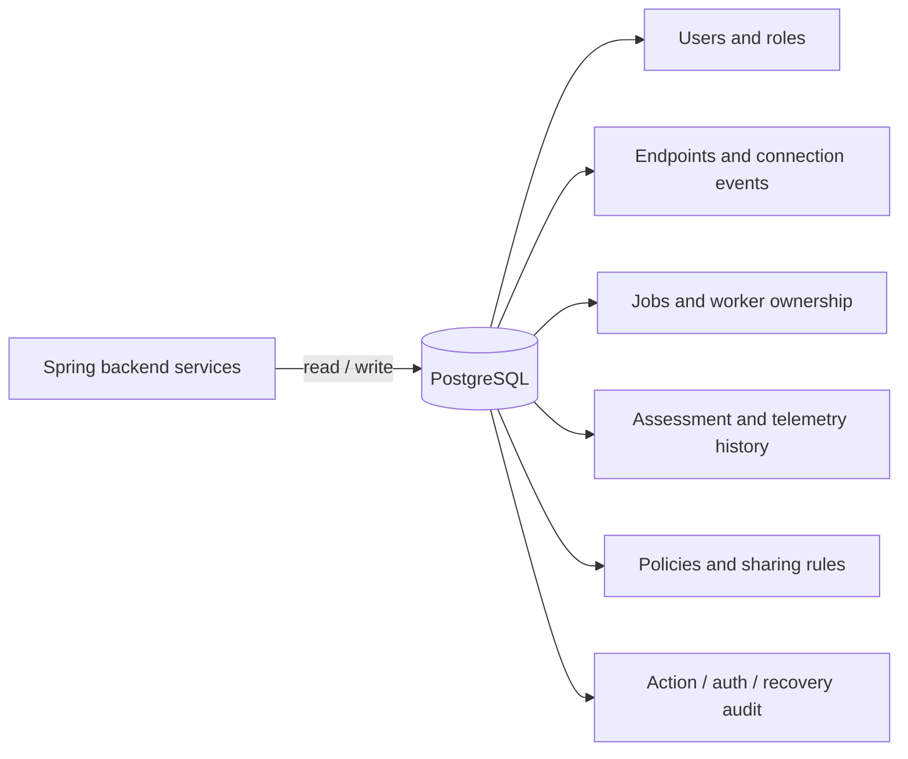
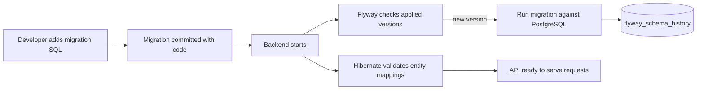
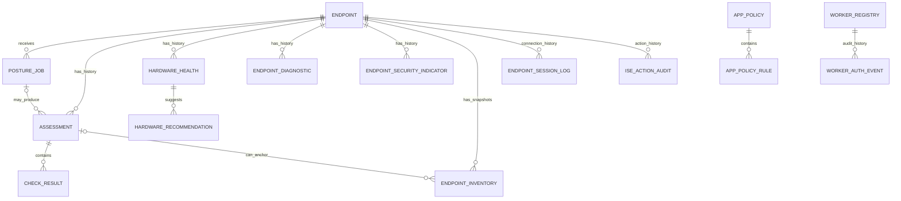
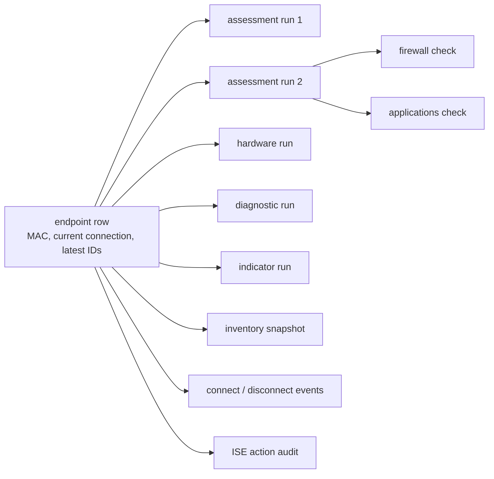
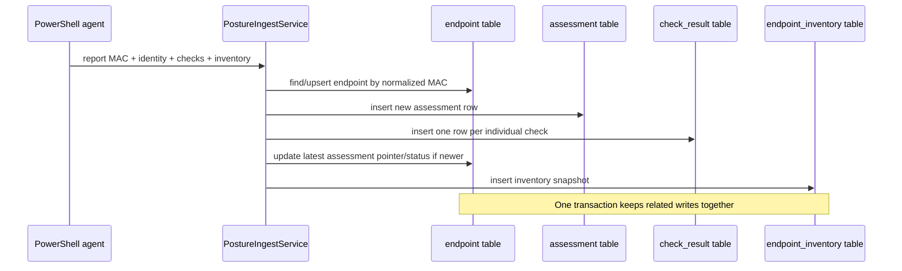
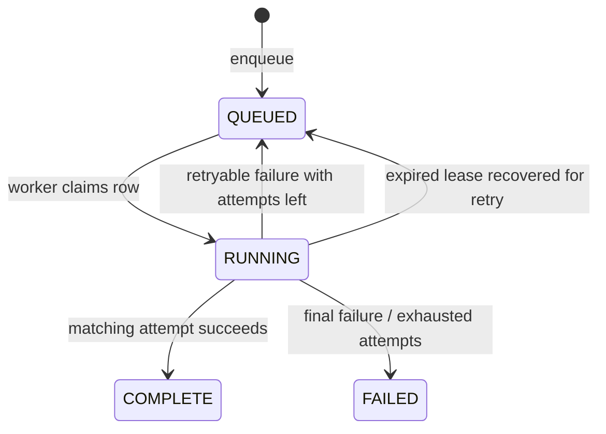

# Database guide for beginners

This guide explains what PostgreSQL stores for Endpoint Posture, how the schema is created, and how backend code reads and writes it. It is meant for someone new to databases, not only for someone who already knows SQL.

For the bigger system picture, see [PROJECT_ARCHITECTURE.md](PROJECT_ARCHITECTURE.md). For how Java classes use this data, see [BACKEND_BEGINNER_GUIDE.md](BACKEND_BEGINNER_GUIDE.md).

## 1. What the database is doing

PostgreSQL is the project's durable memory. It stores:

- who can sign in and what each account is allowed to do;
- endpoint identity and whether ISE currently sees the endpoint connected;
- work waiting in the job queue and what happened to each attempt;
- historical posture, hardware, diagnostic, inventory, and security-indicator evidence;
- ISE session and operator action audit history;
- configuration such as application policy and ISE sharing rules;
- worker identities, enrollment history, leases/recovery, and result acknowledgements.

The database has two important roles: **system of record** for platform data and **durable queue** for collection jobs. Since the queue is a table, queued work survives an application restart.

## 2. Where database definitions live

The main database files are:

| File/location | Meaning |
|---|---|
| `backend/src/main/resources/db/migration/` | Ordered Flyway SQL files that create and change tables, constraints, and indexes. |
| `backend/src/main/java/com/endpointposture/**` | Java entities and repository code used by Spring/JPA and JDBC queries. |
| `backend/src/main/resources/application.yml` | Database connection settings, Flyway configuration, and Hibernate schema validation. |
| `docker-compose.yml` | Local PostgreSQL container configuration. |
| `terraform/modules/postgres/` | AWS RDS PostgreSQL foundation for the future cloud deployment. |

Database settings use environment variables such as `DB_URL`, `DB_USERNAME`, and `DB_PASSWORD`. Do not put real secrets in committed YAML, Terraform variable files, or documentation.

## 3. How the schema gets created and updated

Flyway is a database change runner. It reads numbered files in order, for example `V1__create_users_and_roles.sql`, then records which versions it has applied in its own history table. On the next startup, it applies only new migration versions.

Hibernate is configured with `ddl-auto: validate`: it checks that mapped entities fit the existing schema. It does not own schema evolution. In practice, a schema change should be a new migration plus matching Java changes. Do not edit an already-applied migration to make a new change; add the next version instead. Migration numbers V5-V7 are absent in this repository, so gaps are expected.

## 4. Database words in plain English

| Term | Meaning |
|---|---|
| Table | A named collection of records, like a spreadsheet tab. |
| Row | One record, for example one endpoint or one assessment run. |
| Column | One value on a record, such as `mac_address` or `created_at`. |
| Primary key | The unique ID of a row. Most tables use UUIDs. |
| Foreign key | A database-enforced link to a row in another table. |
| Constraint | A database rule, such as “this value must be unique” or “score must be between 0 and 100.” |
| Index | A lookup helper that makes specific searches and sorts faster, at the cost of extra storage and write work. |
| JSONB | PostgreSQL's structured JSON storage, useful where report details can evolve. |
| Transaction | A set of writes that either all commit or all roll back. |
| Migration | A versioned SQL change to the schema or starting data. |
| Upsert | Insert a row if new, otherwise update the matching row. |
| Append-only history | Add a new row for each event/run instead of rewriting the previous evidence. |
| Pointer | A reference from an endpoint row to its current/latest evidence row, so common reads are quick. |

## 5. The main data model

This diagram shows the core relationships. It leaves out many individual columns so the overall shape is readable.

`o|` means optional in Mermaid ER notation. Worker-authentication and job-recovery audit records are intentionally not connected with foreign keys in this simplified diagram. The worker receipt and recovery event retain historical IDs without foreign keys so audit history can remain even if old operational rows are later removed.

## 6. Table groups and what they mean

### Identity and endpoint state

| Table | Stores |
|---|---|
| `app_user` | User name, password hash, role, enabled/lockout-related state. Passwords are stored as hashes, not plain text. |
| `endpoint` | Stable device identity (unique MAC), hostname/IP/OS/hardware identity, connected flag, seen/session timestamps, and references to latest evidence. |
| `endpoint_session_log` | Append-only connect/disconnect events. Connection state and posture state are separate. |

### Jobs and worker coordination

| Table | Stores |
|---|---|
| `posture_job` | Job type, endpoint, priority, queued/running/completed/failed state, attempts, retry timing, shard, owner, and lease expiry. Despite its historical name, it carries posture, hardware, diagnostic, and security check jobs. |
| `worker_registry` | Enrolled worker name/shard, hashed credential, enabled/revoked state, and last heartbeat. |
| `worker_enrollment_token` | Hashed single-use enrollment tokens, expiry, redemption state, and associated worker. |
| `worker_auth_event` | Worker token/auth/enrollment/revocation events. |
| `job_recovery_event` | Audit record for process timeouts, expired leases, or revoked-worker recovery. |
| `worker_job_result_receipt` | Idempotency receipt for an accepted result envelope, keyed by job and attempt, so the worker can safely retry delivery. |

### Evidence and inventory

| Table | Stores |
|---|---|
| `assessment` | One posture outcome per run: status, detail, times, endpoint and optional job link. |
| `check_result` | One row per check inside an assessment; flexible `details` JSONB contains check-specific evidence. |
| `hardware_health` | Scores, health band, device details, warranty fields, raw report, and collection time. |
| `hardware_recommendation` | Actions suggested by one hardware result. |
| `endpoint_diagnostic` | Endpoint network test results, score, explanation/deductions, and raw JSON report. |
| `endpoint_security_indicator` | Analyzer outcome, possible findings, summary, and raw report. Findings are evidence for a person to review. |
| `endpoint_inventory` | Snapshots of installed applications, ports, processes, and resource usage as JSONB. |
| `warranty_record` | Warranty coverage imported from a vendor CSV and matched by serial number. |

### Configuration, actions, and audit

| Table | Stores |
|---|---|
| `app_policy`, `app_policy_rule` | Versioned required/blocked application rules. Editing creates a new version rather than erasing the old rule set. |
| `ise_sharing_rule` | Versioned scope approved by an administrator for ISE's read-only posture feed. |
| `ise_feed_audit` | Each feed request's timestamp, caller, policy version, and record count; it does not store the feed payload. |
| `ise_action_audit` | Share, Restrict, and Clear attempts, including operator, success/failure, detail, and time. |
| `compliance_daily` | Precomputed per-day compliance counts used by dashboard trends. |

Table names and exact columns are defined by migrations, including migrations beyond the initial table-creation versions. Use `rg "CREATE TABLE|ALTER TABLE" backend/src/main/resources/db/migration` to locate the source definition.

## 7. One endpoint's data over time

`endpoint` is the identity/current-state row. Collection results are separate history rows. The current pointers make frequent dashboard queries fast without discarding the history.

Keep these two questions separate:

- “Is it connected now?” comes from endpoint session state.
- “What did its most recent check say?” comes from assessment/evidence history.

A device can be connected with stale posture, or disconnected while its last assessment is compliant.

## 8. Example: how a posture report is stored

The raw or flexible portion of a report is stored as JSONB when the shape varies by check. Stable fields used for filtering, ordering, joining, or constraints are regular columns. This avoids a schema migration every time a report gains a small detail while preserving queryable key fields.

## 9. Database rules that protect correctness

- **Unique MAC address:** one endpoint identity per normalized MAC.
- **Foreign keys:** evidence and action rows link to known endpoints; a check result links to a known assessment.
- **Checks:** scores, statuses, and scope values are restricted to known ranges/values.
- **Only one active app policy/sharing rule:** partial unique indexes enforce a single current version even if concurrent requests race.
- **One active job per endpoint and job type:** the partial unique index from V30 prevents duplicate queued/running jobs even if two application paths enqueue at once.
- **Claim indexes:** job status/priority/timing indexes make finding eligible queued work faster.
- **Transactions:** related ingestion or service writes commit as one unit, preventing half a report from being treated as complete.
- **Fencing/leases:** job `attempt_count`, `claimed_by`, and `lease_expires_at` protect against stale or competing workers changing current job state.
- **Receipt uniqueness:** one accepted worker-result receipt per job attempt supports idempotent retries.

Indexes improve particular query patterns but are not free: they take disk space and must be maintained on writes. Migrations add them where actual fleet reads/claims need them (for example endpoint search trigram indexes and recent evidence indexes).

## 10. How the queue works inside PostgreSQL

PostgreSQL handles more than simple storage here. The queue is stored in `posture_job`:

Claim queries use row locks with `FOR UPDATE SKIP LOCKED`: if another worker has locked the first eligible row, a concurrent worker skips it and takes a different row. This lets several workers claim safely without a separate broker. For remote execution, a lease expires if a worker disappears. Completion and failure must match the current attempt/owner so an old response cannot close a newer attempt.

## 11. Indexes, JSONB, and performance

The code uses several patterns for scale:

- **B-tree indexes** for common exact lookups and ordered histories (endpoint IDs, event dates, status/priority).
- **Partial unique indexes** for rules that apply only to active jobs or active configurations.
- **GIN indexes** for querying flexible JSONB report fields where useful.
- **Trigram indexes** for substring search of fleet fields such as hostname/MAC.
- **Batch/set-based SQL** for session updates and recheck scheduling rather than one round trip per endpoint.
- **Paged responses** to avoid transferring a whole fleet to the browser.
- **Latest pointers and rollups** to make dashboard summary reads cheaper.

The database migration is where to confirm whether a particular index exists and which columns it supports; do not infer an index from a Java method name.

## 12. Retention and historical records

Data has different lifetimes because operational queue rows and evidence serve different purposes:

- finished job records have a shorter retention window (configured in `application.yml`);
- full inventory payloads are retained for a limited number of recent runs per endpoint, with older payload fields compacted;
- evidence tables have the configured 90-day policy;
- current endpoint pointers and selected newest evidence are protected;
- ISE action state needs the newest Restrict/Clear row to continue describing the current state;
- recovery audit was changed to preserve history even if a referenced endpoint or job is deleted.

The exact delete/compact behavior is implemented in `retention/EvidenceRetentionService`, `inventory/InventoryRetentionService`, and `job/JobRetentionService`. A foreign-key action such as `ON DELETE CASCADE` can remove child rows along with their parent; `ON DELETE SET NULL` preserves a child while clearing its optional job reference. Read both the migration and retention service before assuming a history row is permanent.

## 13. How to trace a database change in the code

For any value you see in the dashboard:

1. Find its TypeScript response interface in `frontend/lib/api.ts`.
2. Find the API endpoint/controller that returns it.
3. Follow the service into its repository/query.
4. Find the entity or SQL projection that shapes the row.
5. Search the migration directory for the table/column/index.

For any new database field:

1. Decide if it is stable/queryable data (regular column) or flexible report detail (potential JSONB).
2. Add a **new** Flyway migration with suitable defaults, constraints, foreign keys, and indexes.
3. Update the matching entity/DTO/service/repository as appropriate.
4. Consider old rows, concurrent operations, retention, and rollback/recovery behavior.
5. Add/update tests when implementation work asks for verification; do not rely on Hibernate to silently mutate the schema.

## 14. Main migrations to study

| Migration | Why it is useful |
|---|---|
| `V1__create_users_and_roles.sql` | First account table and role field. |
| `V2__create_endpoints.sql` | Endpoint identity and current connection state. |
| `V3__create_posture_jobs.sql` | Queue design and concurrency comments. |
| `V4__create_assessments.sql` | Historical posture and individual check model. |
| `V8__create_hardware_health.sql` | Scores, constraints, recommendations, and JSONB report. |
| `V10__create_endpoint_session_log.sql` | Connection history independent of posture. |
| `V12__create_endpoint_inventory.sql` | JSONB inventory snapshots. |
| `V13__create_app_policy.sql` | Versioned required/blocked rules. |
| `V20__latest_assessment_and_rollup.sql` | Latest posture pointers, their backfill, and daily compliance rollup table. |
| `V24__create_ise_sharing_rule.sql` | Audited, versioned ISE sharing scope. |
| `V25`–`V30` migrations | Worker leases/auth, recovery audit, result receipts, and duplicate-active-job protection. |

The migration numbering has intentional gaps. Always use the actual file list as the authority for the exact migration filename.

## 15. Database learning path for this repository

1. Read `V2` to understand endpoint identity.
2. Read `V3` and `V30` to understand the durable queue and uniqueness rule.
3. Read `V4` and `V8` to compare posture and hardware evidence.
4. Read `V10` to see why connection history is its own concept.
5. Follow `PostureIngestService.ingest(...)` to see Java write multiple tables.
6. Read `V25`–`V29` to see how the schema supports remote worker ownership and result delivery.
7. Read `EvidenceRetentionService` and the migrations it touches to understand data lifecycle.

## 16. Related project guides

- [Project architecture](PROJECT_ARCHITECTURE.md)
- [Backend beginner guide](BACKEND_BEGINNER_GUIDE.md)
- [Frontend beginner guide](FRONTEND_BEGINNER_GUIDE.md)
- [Terraform AWS foundation](../terraform/README.md)
