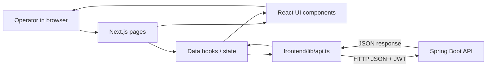
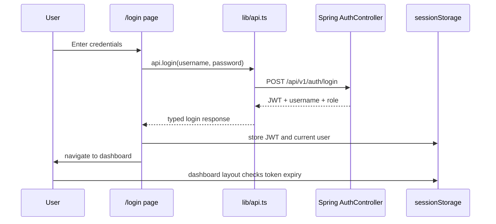
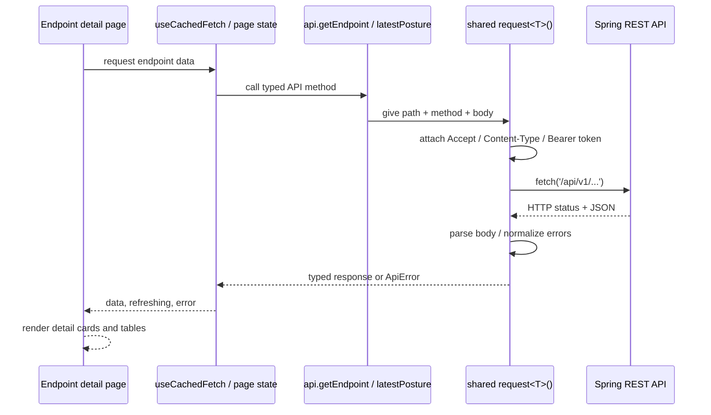
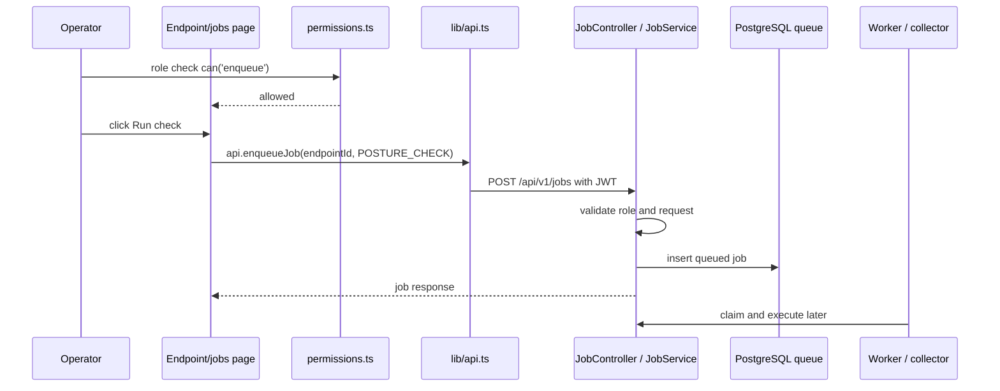

# Frontend guide for beginners

This guide explains the browser application: where pages live, how a page gets data from the Java backend, how login and role-based UI behave, and what the shared components/hooks are for.

The frontend is built with Next.js, React, TypeScript, and Tailwind CSS. Next.js serves the site and provides file-based routes; most dashboard pages are interactive client-side React components that call the backend API.

For the entire system, see [PROJECT_ARCHITECTURE.md](PROJECT_ARCHITECTURE.md). For the Java API and database, see [BACKEND_BEGINNER_GUIDE.md](BACKEND_BEGINNER_GUIDE.md) and [DATABASE_BEGINNER_GUIDE.md](DATABASE_BEGINNER_GUIDE.md).

## 1. What the frontend does

The frontend is the operator's dashboard. It lets a signed-in user view endpoint status and history, inspect evidence, queue checks, manage configuration (if their role allows it), and ask the backend to perform explicit ISE actions.

It does not directly query PostgreSQL or Cisco ISE. It sends HTTP requests to the Spring backend and renders the JSON responses.



## 2. Where frontend code lives

| Path | Purpose |
| --- | --- |
| `frontend/app/` | Next.js routes and layout files. A folder/file path generally becomes a URL route. |
| `frontend/app/(dashboard)/` | Group of signed-in dashboard pages; parentheses group routes without appearing in the URL. |
| `frontend/components/layout/` | Sidebar, top bar, tab status, theme controls. |
| `frontend/components/dashboard/` | KPI cards, charts, risk and activity views. |
| `frontend/components/ui/` | Reusable controls such as tables, badges, dialogs, pagination, and loading/error states. |
| `frontend/components/endpoints/` | Endpoint-specific visualizations and tabs. |
| `frontend/lib/api.ts` | Types, shared HTTP request function, token storage, and core API methods. |
| `frontend/lib/apiExtra.ts` | Additional API methods for paged applications/ports and ISE sharing feed. |
| `frontend/lib/auth.ts`, `session.ts`, `permissions.ts` | Current user, token checks, and UI action visibility. |
| `frontend/lib/useCachedFetch.ts`, `usePolling.ts` | Reusable data refresh behavior. |
| `frontend/lib/usePagination.ts`, `inventory.ts`, `csv.ts` | Page state, inventory helpers, and CSV utilities. |
| `frontend/app/globals.css`, `tailwind.config.ts` | Global styles, colors, and design tokens. |

## 3. Page map

Next.js uses folders and `page.tsx` files to define routes:

| URL | Page file | What the user does there |
| --- | --- | --- |
| `/login` | `app/login/page.tsx` | Sign in and get a session token. |
| `/overview` | `(dashboard)/overview/page.tsx` | Fleet summary, charts, risk/activity snapshots. |
| `/endpoints` | `(dashboard)/endpoints/page.tsx` | Search and filter the endpoint fleet. |
| `/endpoints/[id]` | `(dashboard)/endpoints/[id]/page.tsx` | Inspect one endpoint's posture, hardware, sessions, diagnostics, indicators, and actions. |
| `/compliance` | `(dashboard)/compliance/page.tsx` | Fleet compliance status and check categories. |
| `/hardware` | `(dashboard)/hardware/page.tsx` | Fleet hardware scores and recommendations. |
| `/applications` | `(dashboard)/applications/page.tsx` | Installed applications and compliance against policy. |
| `/ports` | `(dashboard)/ports/page.tsx` | Listening ports and reachability data. |
| `/jobs` | `(dashboard)/jobs/page.tsx` | Queue status, job history, and manual queueing. |
| `/policies` | `(dashboard)/policies/page.tsx` | Required/blocked application policy. |
| `/warranty` | `(dashboard)/warranty/page.tsx` | Warranty coverage and CSV uploads. |
| `/ise-actions` | `(dashboard)/ise-actions/page.tsx` | ISE action history/current state. |
| `/ise-feed` | `(dashboard)/ise-feed/page.tsx` | Preview feed and manage approved sharing rule (admin). |
| `/audit` | `(dashboard)/audit/page.tsx` | Review ISE action audit history. |
| `/users` | `(dashboard)/users/page.tsx` | Manage users and roles (admin). |
| `/system` | `(dashboard)/system/page.tsx` | Backend, ISE, database, queue, and worker health. |

`app/page.tsx` redirects the site root to `/login`. `app/layout.tsx` is the root HTML wrapper and reads the theme cookie before rendering, which prevents a flash of the wrong theme.

## 4. How login becomes an API session

The login page submits username/password using `api.login(...)`. On success it stores the returned JWT in `sessionStorage` and stores username/role for presentation. The dashboard layout checks the token in the browser before it shows dashboard content.



The token is kept in `sessionStorage`, so it is scoped to the current browser tab session rather than a long-lived cookie. The frontend's `isTokenValid(...)` check improves the experience, but the backend remains responsible for validating every request and applying real permissions.

When any API call returns `401`, the shared request helper clears token and user state and redirects the browser to `/login`. A `403` becomes a role/permission error message.

## 5. How a page calls the backend

Example: the endpoint detail page needs a device record and latest posture report.



`lib/api.ts` is the API boundary. Its TypeScript interfaces describe expected JSON, and its `api` object names operations such as `endpointsPage`, `dashboardSummary`, `enqueueJob`, `sharePosture`, and `systemHealth`. `apiExtra.ts` contains additional endpoints. This keeps pages from duplicating URL construction, token headers, JSON parsing, and error behavior.

The frontend usually calls relative paths such as `/api/v1/endpoints/page`. Next.js configuration rewrites `/api/*` to the backend server, so browser calls can use the same origin as the web app. Do not put backend passwords or privileged secrets in frontend code: browser code is visible to users.

## 6. How page data and visual pieces are divided

React pages coordinate data and interactions. Components focus on reusable visual elements. For example, an overview page can request summary/trend data and pass values into `StatCard`, `StatusDonut`, `TrendChart`, and `ActivityFeed`.

```mermaid
flowchart TB
    Route[app/(dashboard)/overview/page.tsx]
    Route --> Fetch[api.dashboardSummary / dashboardTrend]
    Route --> Cards[StatCard components]
    Route --> Donut[StatusDonut]
    Route --> Trend[TrendChart]
    Route --> Risk[RiskList / ActivityFeed]
    Route --> Shared[AsyncState / IseBanner / StatusBadge]
```

Common UI components:

- `DataTable`: render tabular data consistently.
- `PaginationBar`: show page controls and row counts.
- `AsyncState`: render loading, empty, and error states consistently.
- `StatusBadge`: color-coded state labels.
- `ConfirmDialog`: ask for confirmation before consequential actions.
- `ConnectionDot` and `IseBanner`: make connectivity/integration state visible.
- `StatCard`, `RingGauge`, `StatusDonut`, `TrendChart`, `RiskList`, `ActivityFeed`: dashboard visualizations.

## 7. Data hooks: refresh, cache, pagination

### `useCachedFetch`

`useCachedFetch(key, fetcher, options)` is a browser-side stale-while-revalidate cache:

1. If fresh cached data exists, show it immediately.
2. If the cached value is old, request updated data.
3. Poll again on a timer while the page is visible.
4. If a refresh fails, keep the last good data and expose an error flag.

The cache is in memory for the browser tab. `clearFetchCache()` is called around sign-in/sign-out so one user's cached data is not reused for another user.

### `usePolling`

`usePolling` invokes a callback at an interval only while the browser tab is visible. It also listens for a visibility change so a returning tab can refresh. This reduces unnecessary requests when a dashboard is hidden.

### `usePagination`

`usePagination` manages a table's current page and page size, clamps the page if filtering shrinks the results, and remembers the selected page size in tab state/session storage. Some large fleet APIs instead use **server-side pagination**: the frontend sends page/size/search filters and the backend returns only that slice plus the total count. `PageResponse<T>` models that shape.

## 8. Role-aware interface

`lib/permissions.ts` maps UI actions to roles. For example, only admins see policy/user/sharing-rule controls; operators can restrict/clear; analysts can request checks/share posture but not restrict. Components call `can(action)` to hide or disable controls and can show a `DENIED_HINT`.

This improves the user experience, but it is not security enforcement. The backend's Spring Security filters and method-level authorization must independently reject unauthorized API requests. A user can modify browser JavaScript, so only the server is trusted to decide.

```mermaid
flowchart LR
    User[Current user role] --> UI[permissions.ts can(action)]
    UI -->|allowed| Show[Show enabled control]
    UI -->|not allowed| Hide[Hide/disable control + hint]
    Show --> Request[API request]
    Request --> Server[Backend security authorization]
    Server -->|authorized| Work[Perform operation]
    Server -->|denied| Forbidden[HTTP 403]
```

## 9. A button click from page to real effect

For a meaningful example, an operator clicks “Run posture check”:



The click usually returns after the job has been queued; it does not wait for the endpoint to finish. The jobs page or detail page can poll for status, and the evidence page later reads the stored result.

For ISE actions, the flow is also a separate authenticated API call and the UI uses a confirmation dialog before it reaches the backend. The backend records the action attempt and talks to ISE; the frontend displays the result and can refresh the action state.

## 10. Loading, empty, and error states

API calls may take time or fail. Pages should make these states clear:

- **Loading:** first request has not returned; show a spinner/skeleton or `LoadingState`.
- **Empty:** request succeeded but no matching data exists; explain what is empty.
- **Refreshing:** stale data remains visible while a background refresh is running.
- **Error:** show a useful message and allow retry when appropriate.
- **Unauthorized/forbidden:** redirect on expired login or explain that the role cannot perform an action.

`ApiError` carries the status and parsed response body. `request<T>()` handles transport failures, JSON/text response parsing, common messages, 401 logout, and 403 wording. Pages can then use `AsyncState` or a page-specific message instead of each inventing fetch behavior.

## 11. Styling and themes

Tailwind utility classes style most elements. `tailwind.config.ts` defines semantic theme colors such as background, panel, ink, accent, and warning. `globals.css` defines CSS variables and global defaults. `ThemeToggle` updates the theme preference in a cookie; the root server layout reads that cookie to render the selected theme without a flash.

Layout components establish the application frame:

- `Sidebar` provides route navigation and mobile menu behavior.
- `Topbar` displays user context, theme control, and mobile navigation control.
- `DashboardLayout` validates the browser session, provides shared integration status, and frames each dashboard page.
- `IseStatusProvider` makes ISE health available to the shared banner/status UI.

## 12. Frontend page-to-API map

Representative links between pages and backend API operations:

| Frontend page | Main frontend API methods | What comes back |
| --- | --- | --- |
| Overview | `dashboardSummary`, `dashboardTrend`, `dashboardCategories` | Fleet counts, trend points, check-category rates. |
| Endpoints | `endpointsPage` | Searchable/page-limited endpoint list with latest posture status. |
| Endpoint detail | `getEndpoint`, `latestPosture`, `postureHistory`, `latestHardwareOrNull`, `sessionHistory`, `diagnosticHistory`, `securityHistory`, `listJobsForEndpoint` | Device identity and related evidence/history. |
| Compliance | `dashboardSummary`, `dashboardCategories`, posture queries | Compliance counts and category details. |
| Hardware | `hardwarePage`, `hardwareSummary` | Paged hardware fleet state and aggregate metrics. |
| Applications | `apiExtra.applicationsPage`, `applicationsSummary` | Paged application inventory and policy status. |
| Ports | `apiExtra.portsPage`, `portsSummary` | Paged listening port information and aggregate counts. |
| Jobs | `listJobs`, `enqueueJob`, `bulkEnqueue` | Queue state and queue requests. |
| Policies | `policy`, `policyHistory`, `updatePolicy` | Current/versioned app requirements and blocked rules. |
| Warranty | `listWarranty`, `uploadWarrantyCsv` | Coverage rows and upload outcome. |
| ISE actions | `iseActionsState`, `sharePosture`, `restrict`, `clearRestriction` | Latest state and action outcomes. |
| ISE feed | `apiExtra.sharingRule`, `sharingRuleHistory`, `iseFeedPreview`, `updateSharingRule` | Approved rule and paged feed preview. |
| Audit | `auditActions` | Historical operator actions. |
| Users | `users`, `createUser`, `updateUser`, `resetPassword`, `deleteUser` | Account administration results. |
| System | `systemHealth`, `iseStatus` | API, database, queue, worker, and ISE health. |

These are examples based on the API client; open the current page implementation to confirm its exact loading strategy and selected fields.

## 13. Beginner vocabulary

| Word | Plain meaning |
| --- | --- |
| React component | A reusable piece of UI described by a function. |
| Page/route | A screen associated with a URL. |
| Props | Values one component passes to another component. |
| State | Values that can change and cause React to render again. |
| Hook | A reusable React function for state or side effects; names start with `use`. |
| TypeScript interface/type | A description of the data shape expected by the code. It helps during development, but does not validate server data at runtime by itself. |
| `fetch` | Browser API for sending an HTTP request. |
| Client component | A component that runs interactively in the browser; marked with `"use client"`. |
| Server component | A component rendered on the server by Next.js; can access server-only facilities. |
| `sessionStorage` | Browser storage scoped to a tab session. |
| Polling | Repeating a request every interval to get fresh state. |
| Stale-while-revalidate | Show cached data first, then refresh it in the background. |
| Responsive design | Layout adjusts to different screen widths, including phones. |

## 14. A practical frontend reading path

1. `app/page.tsx` and `app/layout.tsx` — root redirect and shared HTML/theme.
2. `app/login/page.tsx` — login form and session setup.
3. `(dashboard)/layout.tsx` — route guard and shared dashboard frame.
4. `components/layout/Sidebar.tsx` and `Topbar.tsx` — navigation shell.
5. `lib/api.ts` — API types, common request handling, and endpoint methods.
6. `(dashboard)/endpoints/page.tsx` — a paginated list screen.
7. `(dashboard)/endpoints/[id]/page.tsx` — a multi-section detail screen.
8. `lib/useCachedFetch.ts` and `usePolling.ts` — data freshness behavior.
9. `lib/permissions.ts` plus a page with an action — role-aware controls.
10. `components/ui/AsyncState.tsx`, `DataTable.tsx`, and `ConfirmDialog.tsx` — shared UI patterns.

When reading a page, ask: **What state does it own? Which API method does it call? What can the user do? Which components display the result? What happens on loading, empty data, or error?**

## 15. Related project guides

- [Project architecture](PROJECT_ARCHITECTURE.md)
- [Backend beginner guide](BACKEND_BEGINNER_GUIDE.md)
- [Database beginner guide](DATABASE_BEGINNER_GUIDE.md)
- [Project run instructions](../README.md)
