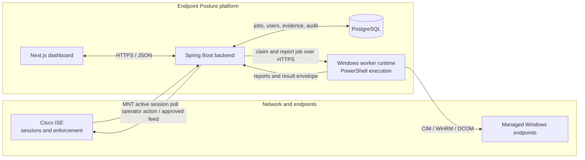
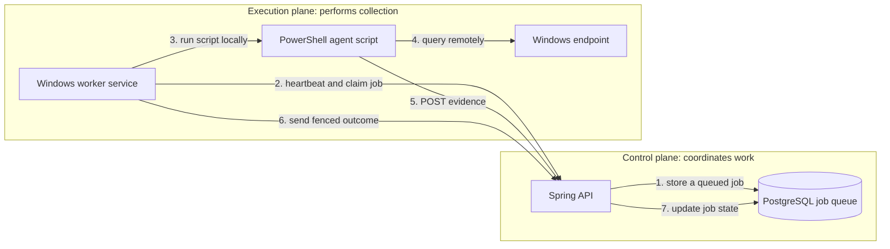
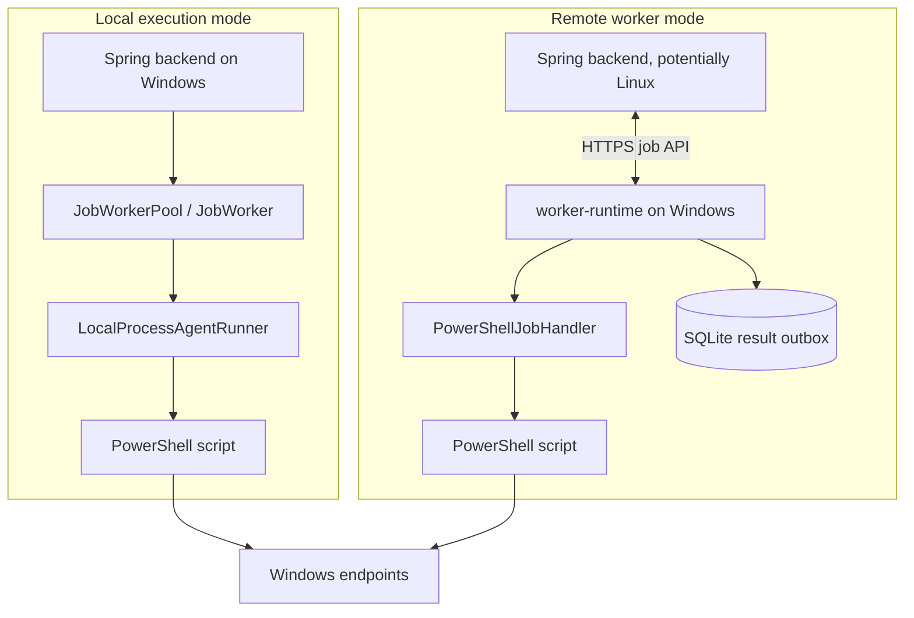
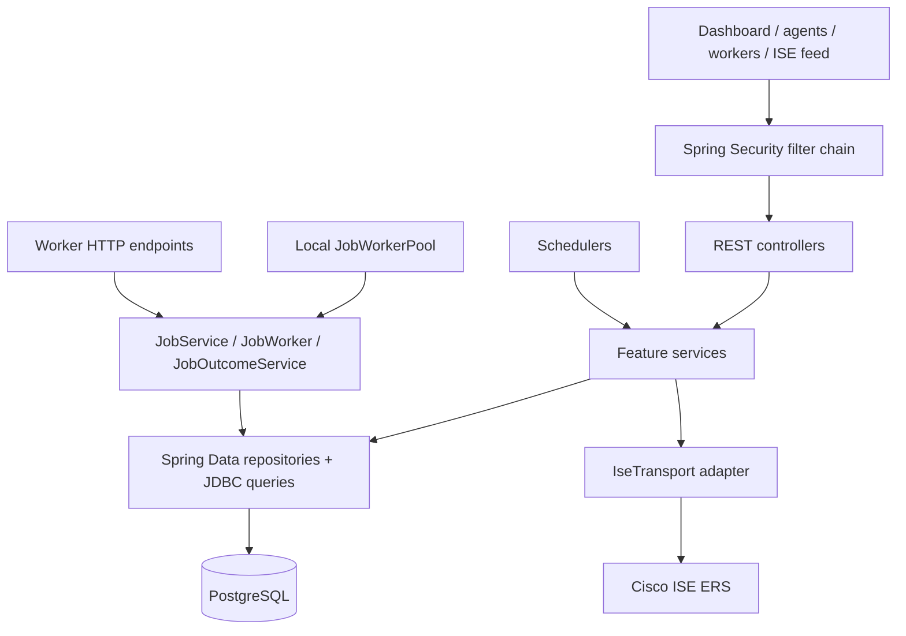
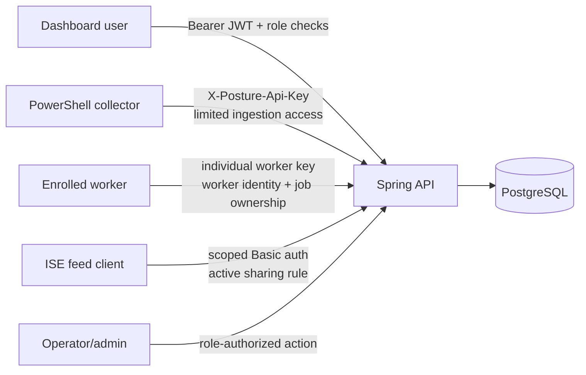
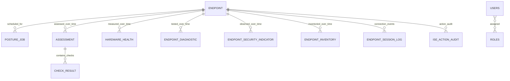
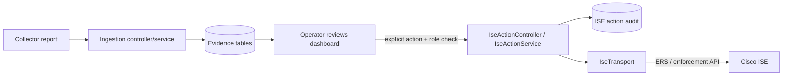
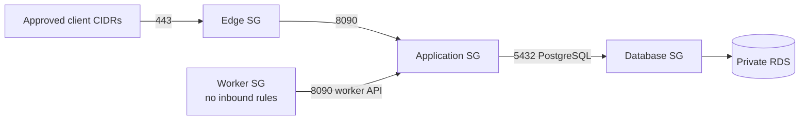

# Endpoint Posture project architecture

This document explains the architecture of the whole project: what problem it solves, why the worker layer exists, how the backend and collectors cooperate, what the Terraform foundation builds, and which parts are implemented versus planned.

It is written as a guided tour. Start at [the problem and solution](#1-the-problem-this-project-solves), then follow the diagrams from system view to a single job. For Java terminology, see [BACKEND_BEGINNER_GUIDE.md](BACKEND_BEGINNER_GUIDE.md).

## 1. The problem this project solves

An organization needs to know which computers are connected, whether they meet security and hardware expectations, and what evidence supports that view. Cisco ISE knows about network sessions and can enforce network access, but collecting useful endpoint detail and presenting its history requires additional software.

The project joins those pieces:

1. Cisco ISE reports active network sessions.
2. The platform identifies endpoints and decides which checks are due.
3. A collector runs on a centrally managed Windows worker and queries endpoints remotely using Windows management protocols.
4. The collector submits structured results to the backend.
5. The backend stores history and serves dashboards and APIs.
6. A human reviews evidence and may request an explicit action in ISE.

The guiding rule is:

```text
Observe -> Collect -> Store -> Review -> Act (only by an authorized human or approved sharing rule)
```

Collected posture, hardware, diagnostic, or security indicator data does **not** itself restrict a device. ISE remains the enforcement authority.

## 2. The whole project at a glance



This diagram shows the **target split deployment**. In the current local/verified mode, the backend itself starts PowerShell using `LocalProcessAgentRunner`; a remote `worker-runtime` is not required for that mode. The same job concepts support both modes.

## 3. Why put workers between the API and the endpoints?

The collectors are PowerShell scripts. They rely on Windows capabilities such as CIM, WinRM, DCOM, and Windows credential protection. The backend also needs to stay responsive while endpoint checks take seconds or sometimes time out.

The worker is a small, centrally hosted Windows program that provides a controlled bridge:



### What this separation solves

| Constraint | Design response |
|---|---|
| API should answer dashboard requests even while checks run | A separate worker process performs blocking PowerShell work. In local mode the `JobWorkerPool` isolates it in background threads. |
| PowerShell and Windows remoting are a poor fit for a Linux API host | Put PowerShell execution on centrally hosted Windows runners. The API can then run on Linux. |
| A large number of endpoints should not require a software service installed on every endpoint | The worker is installed on a small, centrally managed runner fleet and remotely collects from endpoint machines. |
| The API must not hand the same job to two workers | PostgreSQL claim locking, worker ownership, attempt numbers, and expiring leases fence job attempts. |
| Long checks must not make a worker look dead | The worker control loop sends heartbeats independently from its PowerShell execution thread. Long work can renew its lease. |
| A network interruption should not lose a result after collection | The runtime stores completed result envelopes in a durable SQLite outbox and retries delivery; it waits for a matching backend receipt before deleting them. |
| One failed endpoint must not stop the fleet | Timeouts, bounded retry/backoff, worker polling, and multiple worker processes isolate failures and let work continue. |
| Workers need revocable identity | Workers enroll with a single-use token, then authenticate with an individual worker key that can be revoked. |

The worker does **not** make the endpoint trust the collector. It is a managed execution host with a scoped identity. Its network route and Windows collection credentials still need to be configured for the endpoint sites it serves.

### Local runner and remote worker are different execution locations



The backend keeps process execution behind the `AgentRunner` interface. `LocalProcessAgentRunner` is the real local implementation; `SimulatedAgentRunner` is used in the simulation profile. Remote execution uses the worker API and the separate `worker-runtime` program.

## 4. One job, explained step by step

An operator, reconnect event, or timer creates a job. A job is a durable instruction such as “run a posture check for endpoint X.” It is stored in PostgreSQL before execution.

```mermaid
sequenceDiagram
    participant Trigger as Operator / ISE watcher / recheck scheduler
    participant API as Spring backend
    participant DB as PostgreSQL
    participant Worker as Local or remote worker
    participant PS as PowerShell collector
    participant Endpoint as Target endpoint
    Trigger->>API: request or schedule a check
    API->>DB: insert QUEUED job
    Worker->>API: heartbeat, then claim eligible job
    API->>DB: claim safely; mark RUNNING and assign attempt/lease
    API-->>Worker: typed job specification
    Worker->>PS: execute collector with validated arguments
    PS->>Endpoint: collect data via Windows remote management
    PS->>API: POST evidence to its ingestion endpoint
    API->>DB: save assessment / hardware / diagnostic / indicator evidence
    PS-->>Worker: collection and submission outcome
    Worker->>API: submit result envelope for this attempt
    API->>DB: accept receipt and complete/fail the job
    API-->>Worker: acknowledge matching result receipt
```

### Why there are both evidence and a job result

These are two related but different records:

- **Evidence** is the observation itself (for example, an assessment and its individual checks). It answers “what did the endpoint report?”
- **Job state** answers “did the requested work finish, which attempt ran it, and should it be retried?”

This separation makes the evidence history useful for dashboards while the queue can retry and recover operational work. The worker result envelope includes the job/attempt identity; the backend can reject stale, unowned, or duplicate submissions and return a receipt acknowledgement.

## 5. Backend component architecture

The Spring Boot backend is a modular monolith: one deployable application separated into feature packages. Most synchronous API requests pass through controller -> service -> repository. Background job execution and scheduled tasks also call services, without going through HTTP controllers.



### Major backend areas

| Area | Responsibility |
|---|---|
| `security` | User login, JWT validation, roles, API key authentication, rate limiting, and response security headers. |
| `endpoint` | Stable endpoint identity, fleet listing, search, and endpoint detail reads. |
| `session` | Poll ISE's active sessions and record connected/disconnected history. |
| `job` | Queue records, safe job claims, job specifications, local dispatch, retry outcomes, scheduled rechecks, and stale job recovery. |
| `worker` | Remote worker enrollment/authentication, heartbeat, sharded claims, leases, result envelopes, and acknowledgements. |
| `posture` | Store assessments and per-check posture evidence. |
| `hardware` | Store component health reports and derived health bands/recommendations. |
| `diagnostic` | Store endpoint network test results and transparent diagnostic scores. |
| `indicator` | Analyze sampled connection data and store possible security indicators for human review. |
| `ise` / `isefeed` | Explicit operator actions to ISE and separately scoped, admin-approved sharing rules/feed. |
| `dashboard` | Aggregated KPIs, trends, and dashboard query results. |
| `inventory` / `policy` / `warranty` | Application inventory, versioned app rules, and uploaded warranty data. |
| `audit` / `retention` / `system` | Audit queries, bounded cleanup, and operational health reporting. |

### Trust boundaries and credentials



The four credentials are not interchangeable. Dashboard users need JWTs; collectors use a narrow ingestion API key; remote workers use individually enrolled keys; ISE feed clients use a dedicated feed credential. Role and route checks happen on the server.

## 6. Data architecture: what is stored

PostgreSQL is both the system of record and the durable job queue. Flyway migration files define the database schema. JPA entities map important records to Java; some high-volume fleet operations use explicit set-based SQL for fewer database round trips.



Each endpoint keeps convenient pointers to current evidence. This is why “latest posture” can be read efficiently while historical reports remain separate rows. Connection status and posture status are separate facts: a device may be offline but have a good last assessment, or online with stale evidence.

Retention is part of the architecture, not an afterthought: finished jobs age out sooner than evidence; full inventory payloads have their own compaction; evidence has a configured 90-day window while records needed for current pointers/state are protected.

## 7. Discovery and periodic work

The `IseSessionWatcher` polls ISE at a configured interval. For a successful poll it compares the current session set against connected endpoints: appeared, still present, and missing. A failed poll is treated as an integration failure, not as an empty device list. Missing devices require a grace count before disconnecting to avoid flapping.

```mermaid
flowchart TD
    Tick[@Scheduled ISE watcher tick] --> Poll[Fetch ISE active-session list]
    Poll -->|failed| Freeze[Record link health; leave endpoint state unchanged]
    Poll -->|successful| Compare[Compare session MACs with connected endpoint MACs]
    Compare --> New[Newly seen: connect and log event]
    Compare --> Seen[Still seen: refresh IP / last-seen when needed]
    Compare --> Missing[Missing: increment successful-miss count]
    Missing -->|grace threshold reached| Disconnect[Disconnect and log event]
    New --> MaybeJob[Queue posture check when eligible]
```

The `RecheckScheduler` periodically queues posture and hardware checks for connected endpoints when their previous successful check is old enough. It avoids duplicate queued/running jobs, backs off after recent failure, limits the number queued per sweep, and prioritizes endpoints that have waited longest. Other scheduled tasks refresh rollups, recover stuck jobs, and prune old data.

## 8. ISE actions and the human decision

Observation and enforcement deliberately follow separate code paths:



`Share`, `Restrict`, and `Clear` are separate actions with role checks and audit rows on success or failure. `ErsIseTransport` implements the ISE protocol behind the `IseTransport` interface. A standing feed is different: an admin approves and audits a versioned sharing rule, then ISE reads only matching records from the read-only feed. Restrict and Clear remain individual actions.

## 9. AWS / Terraform architecture

The Terraform code is an **infrastructure foundation** for the production target in `Doc/DECISIONS.md`; it is not a complete application deployment. The actual Terraform modules currently create network boundaries and PostgreSQL RDS. They do not create the backend compute, worker EC2 fleet, public load balancer, TLS certificate, VPN/site routing, or application secret injection.

```mermaid
flowchart TB
    Internet[Approved users / dashboard clients] --> EdgeSG[Edge security group<br/>HTTPS ingress rules]
    subgraph AWS[AWS VPC across two Availability Zones]
        subgraph Public[Public edge subnets]
            Edge[Future TLS load balancer / proxy<br/>not created yet]
            NAT[Optional NAT gateway(s)]
        end
        subgraph App[Private application subnets]
            API[Future Linux Spring API<br/>not created yet]
            W[Future Windows worker fleet<br/>not created yet]
        end
        subgraph Data[Isolated data subnets]
            RDS[(Encrypted private PostgreSQL RDS 16)]
        end
    end
    ISE[Cisco ISE / endpoint site networks] <-->|planned network connectivity| API
    W -->|HTTPS job API| API
    W -->|planned site routes + Windows remote management| Endpoints[Managed endpoints]
    API -->|5432 allowed from application security group| RDS
    Edge -->|8090 allowed from edge security group| API
    NAT -. optional outbound route .-> App
```

### What Terraform creates today

| Terraform area | Current responsibility |
|---|---|
| `terraform/main.tf` | Composes network and PostgreSQL modules and supplies shared naming/tags. |
| `terraform/modules/network` | Two-AZ VPC; public edge, private application, and isolated data subnets; route tables; edge, worker, application, and database security groups; optional NAT. |
| `terraform/modules/postgres` | Encrypted, private PostgreSQL RDS instance, subnet group, managed master password, backups, storage autoscaling, optional Multi-AZ, and deletion protection. |
| `terraform/environments/*.tfvars.example` | Example environment inputs for dev/staging/prod. |
| `terraform/environments/*.backend.hcl.example` | Separate remote Terraform state keys for environments. |

### Intended network permissions



The network module describes security group boundaries, but workload egress is currently permissive while the destination CIDRs and endpoints are undecided. The README correctly calls out that egress restriction, endpoint-site routes, and ISE connectivity are deployment gates. Review actual plan output and security design before deploying workloads.

Secrets are also only partially covered: RDS manages its master password in Secrets Manager. The application database user/password, JWT secret, seed admin password, ISE credentials, and worker enrollment lifecycle still need separate secret provisioning. Terraform outputs must not be used to reveal those secrets.

## 10. Why this architecture is a fit

- **PostgreSQL-backed queue first:** it is already present, durable, and supports safe concurrent claims. There is no broker to operate. The decision record says to introduce systems such as Kafka only when measured throughput or topology needs justify them.
- **Central Windows workers:** they preserve the working PowerShell collection approach while allowing the API tier to move to Linux. They are not endpoint-installed agents.
- **Small, explicit API boundaries:** each caller type has its own authentication and route scope.
- **Durable evidence plus job lifecycle:** the application can show history and still reason about retries, leases, stale attempts, and worker recovery.
- **ISE adapter and audit:** ISE actions have an isolated transport boundary and an audit trail, while collected evidence remains non-enforcing.
- **Terraform modules:** network and database building blocks can be repeated across environments without pretending that an incomplete compute/deployment story is already implemented.

## 11. Current state versus target state

| Capability | Current code / repository state |
|---|---|
| Spring backend and dashboard | Implemented in `backend/` and `frontend/`. |
| Local PowerShell execution | Implemented; backend launches scripts through `AgentRunner` on a Windows host. |
| Remote worker protocol/runtime | Implemented in `worker/` backend package and `worker-runtime/`; worker enrollment, heartbeat, claim/lease, PowerShell execution, and durable result handoff are present in current source. |
| Endpoint remote collection | Implemented through PowerShell agents and Windows remoting; endpoint machines do not host the platform's worker service. |
| AWS VPC, security groups, and RDS foundation | Implemented as Terraform modules. |
| AWS API/worker compute, ALB/TLS, and site connectivity | Not created by current Terraform. |
| Full production deployment and live ISE verification | Requires environment-specific configuration and operational verification; consult `PRODUCTION_CHECKLIST.md` and `DECISIONS.md`. |

## 12. How to read this architecture against the source

Follow one concept from the diagram into code:

| Diagram concept | Code starting point |
|---|---|
| Application startup | `backend/src/main/java/com/endpointposture/EndpointPostureApplication.java` |
| Local job dispatch | `job/JobWorkerPool`, `job/JobWorker`, `job/AgentRunner`, `job/LocalProcessAgentRunner` |
| Remote worker API | `worker/WorkerController`, `worker/WorkerJobService`, `worker/WorkerAuthFilter`, `worker/WorkerResultService` |
| Worker executable | `worker-runtime/.../WorkerMain.java`, `WorkerBootstrap.java`, `WorkerLifecycle.java` |
| Worker collection/outbox | `worker-runtime/.../execution/PowerShellJobHandler.java`, `PowerShellExecutor.java`, `ResultDispatcher.java`, `SqliteJobResultHandoff.java` |
| Session discovery | `session/IseSessionWatcher.java`, `session/IseSessionClient.java`, `session/SessionBatchWriter.java` |
| Evidence storage | `posture/PostureIngestService.java`, plus `hardware/`, `diagnostic/`, and `indicator/` ingest services |
| ISE actions | `ise/IseActionController.java`, `IseActionService.java`, `ErsIseTransport.java` |
| AWS foundation | `terraform/main.tf`, `terraform/modules/network/`, `terraform/modules/postgres/` |

For simple explanations of controllers, services, entities, DTOs, and key methods, see [BACKEND_BEGINNER_GUIDE.md](BACKEND_BEGINNER_GUIDE.md). For data tables and migrations, see [DATABASE_BEGINNER_GUIDE.md](DATABASE_BEGINNER_GUIDE.md). For routes and browser interactions, see [FRONTEND_BEGINNER_GUIDE.md](FRONTEND_BEGINNER_GUIDE.md). For deployment decisions and current open work, see [DECISIONS.md](DECISIONS.md), [TERRAFORM README](../terraform/README.md), and [PRODUCTION_CHECKLIST.md](PRODUCTION_CHECKLIST.md).
