# Endpoint-Posture-Java
## High-Level Design (HLD), System Architecture and AWS Deployment Blueprint

**Document status:** Architecture proposal / target-state design  
**Prepared:** 18 November 2026  
**Primary deployment decision:** Amazon ECS on AWS Fargate, with Amazon ECR  
**Application stack:** Java 21, Spring Boot, Next.js, PostgreSQL, Windows Java worker runtime

---

## 1. Executive summary

Endpoint-Posture-Java is a distributed endpoint posture management platform. It provides a web dashboard and APIs for managing endpoints, posture assessments, inventory, policies, jobs, workers, ISE feed integration, audit history and operational reporting.

The proposed architecture separates the application control plane from the endpoint execution plane. The supplied architecture diagram is the primary logical view for this document: it shows the presentation layer, AWS cloud environment, Linux application environment, Windows execution environment, data layer and external systems. ECS/Fargate and ECR are deployment implementation choices for the Linux application environment and image delivery; they are not separate application domains in that logical view:

- **Control plane:** A Linux-hosted Spring Boot application, packaged as a Docker image and deployed as an Amazon ECS service using AWS Fargate.
- **Execution plane:** A separately scaled fleet of Windows EC2 workers. Each worker runs the Java worker runtime and invokes PowerShell to collect endpoint posture and evidence.
- **Persistence:** PostgreSQL, proposed as Amazon RDS for the AWS deployment.
- **Container delivery:** Amazon ECR stores versioned backend images. ECS task definitions reference the image and define runtime configuration and resources.
- **User access:** A Next.js dashboard and external API consumers access the backend through an Application Load Balancer (ALB).
- **Operations:** CloudWatch provides logs, metrics and alarms. AWS Secrets Manager and KMS support secret storage and encryption.

The recommended compute choice for the Linux backend is **ECS with the Fargate launch type**, not ECS on EC2. Fargate removes the need to manage EC2 container hosts. Windows workers remain on EC2 because they have a distinct Windows service and PowerShell execution requirement.

This is a target architecture, not a statement that every AWS component is already deployed. The current project audit reported backend verification passing, while compatibility review and selective integration remained outstanding. Live AWS-to-Cisco ISE connectivity is also not assumed.

## 2. Goals and design principles

### 2.1 Goals

1. Manage endpoint identity, inventory and posture state.
2. Create and distribute posture assessment jobs.
3. Execute endpoint checks on independent Windows workers.
4. Authenticate workers and constrain them to their assigned shards.
5. Handle long-running work with leases and renewals.
6. Recover abandoned or interrupted jobs.
7. Persist posture results, evidence and audit history.
8. Provide an operator-facing dashboard and API.
9. Support horizontal scaling of the backend and independent scaling of workers.
10. Establish a reproducible AWS deployment and CI/CD path.

### 2.2 Design principles

- Separate control-plane orchestration from endpoint execution.
- Keep the backend stateless where practical; persist durable state in PostgreSQL.
- Treat worker identity, shard authorization and lease ownership as security boundaries.
- Use deterministic ordering for paginated history queries.
- Preserve existing API contracts unless a deliberate version or compatibility change is approved.
- Scale backend API capacity independently from worker execution capacity.
- Represent implemented, planned and future-integrated components honestly in architecture documentation.
- Prefer managed AWS services where they reduce operational burden without obscuring important system behavior.

## 3. System context

### 3.1 Actors and external systems

| Actor / system | Interaction |
|---|---|
| System administrator | Manages users, policies, workers and system configuration |
| Network / security operator | Reviews posture, inventory, jobs, compliance and audit data |
| External API consumer | Calls authenticated application APIs |
| Managed endpoints | Are queried by Windows workers during posture checks |
| Cisco Identity Services Engine (ISE) | External integration target for feed and related workflows |

### 3.2 System context diagram

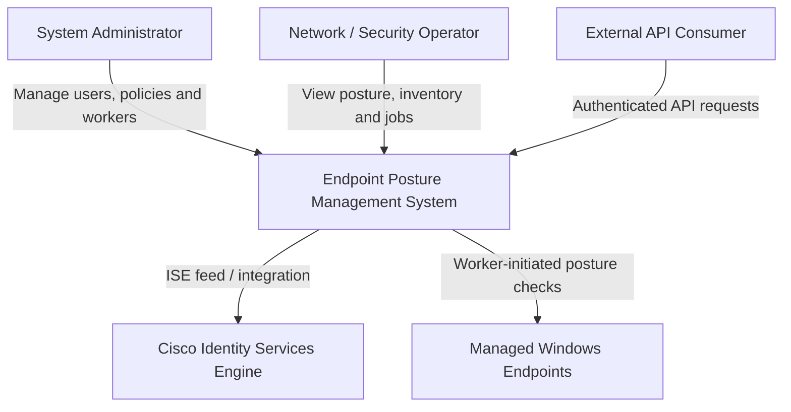

**Connectivity note:** Cisco ISE should be labelled as an external or future integration until the required network connectivity and live integration are available. The architecture must not imply an established AWS-to-ISE connection where none exists.

## 4. High-level logical architecture

### 4.1 Architectural layers

1. **Presentation layer:** Next.js dashboard and external API clients.
2. **Entry layer:** Application Load Balancer and TLS.
3. **Application control plane:** Spring Boot REST API and domain services, running as ECS Fargate tasks.
4. **Execution plane:** Windows EC2 worker fleet running the Java worker runtime and PowerShell handlers.
5. **Persistence layer:** PostgreSQL, proposed as Amazon RDS.
6. **Operations and security services:** CloudWatch, Secrets Manager, KMS and IAM.

### 4.2 High-level architecture diagram

The following diagram is the architecture baseline supplied for this HLD. It preserves the depicted layers and service boundaries:

- Users and presentation: security/network operators, administrators, the Next.js dashboard and external API consumers.
- AWS network entry: Application Load Balancer followed by TLS termination.
- Linux application environment: Spring Boot REST API on Java 21 and the application services.
- Windows execution environment: independently running Windows workers, each with a PowerShell executor.
- Data layer: PostgreSQL / RDS and the logical data groupings shown below.
- External systems: Cisco ISE and managed endpoints.
- Operations: CloudWatch / monitoring.

The Linux application environment is the logical runtime boundary. For the AWS deployment target described later in this document, host the Spring Boot API in an ECS service using Fargate and publish its container image through ECR.

```mermaid
flowchart TB
    subgraph PRESENTATION["1. Users and Presentation Layer"]
        OPERATOR["Security / Network Operator"]
        ADMIN["Administrator"]
        DASHBOARD["Next.js Web Dashboard"]
        CONSUMERS["External API Consumers"]

        OPERATOR --> DASHBOARD
        ADMIN --> DASHBOARD
    end

    subgraph AWS["2. AWS Cloud Environment"]
        subgraph ENTRY["Network and Entry Layer"]
            ALB["Application Load Balancer"]
            TLS["TLS Termination"]
            ALB --> TLS
        end

        subgraph LINUX["Linux Application Environment"]
            API["Spring Boot REST API<br/>Java 21"]

            subgraph SERVICES["Application Services"]
                AUDIT["Audit and Reporting"]
                JOBS["Job Management and Enqueue"]
                AUTH["Authentication and RBAC"]
                INVENTORY["Endpoint Inventory Service"]
                POSTURE["Posture Assessment Service"]
                POLICY["Policy Management"]
                REGISTRY["Worker Registry"]
                ISE_FEED["ISE Feed and Integration"]
                RECOVERY["Job Recovery and Lease Management"]
            end

            API --> AUDIT
            API --> JOBS
            API --> AUTH
            API --> INVENTORY
            API --> POSTURE
            API --> POLICY
            API --> REGISTRY
            API --> ISE_FEED
            API --> RECOVERY
        end

        subgraph DATA["Data Layer"]
            DB[("PostgreSQL / RDS")]
            AUDIT_DATA["Audit and Assessment History"]
            JOB_DATA["Jobs and Worker Leases"]
            ENDPOINT_DATA["Endpoint and Posture Data"]
            POLICY_DATA["Policies and Configuration"]

            DB --> AUDIT_DATA
            DB --> JOB_DATA
            DB --> ENDPOINT_DATA
            DB --> POLICY_DATA
        end

        subgraph WINDOWS["Windows Execution Environment"]
            W1["Windows Worker 1"]
            W2["Windows Worker 2"]
            WN["Windows Worker N"]
            PS1["PowerShell Executor"]
            PS2["PowerShell Executor"]
            PSN["PowerShell Executor"]

            W1 --> PS1
            W2 --> PS2
            WN --> PSN
        end

        MONITOR["CloudWatch / Monitoring"]
    end

    subgraph EXTERNAL["3. External Systems"]
        ISE["Cisco ISE"]
        ENDPOINTS["Managed Endpoints"]
    end

    DASHBOARD --> ALB
    CONSUMERS --> ALB
    TLS --> API

    W1 -->|"Authenticated heartbeat / job claim / results"| ALB
    W2 -->|"Authenticated heartbeat / job claim / results"| ALB
    WN -->|"Authenticated heartbeat / job claim / results"| ALB

    API --> DB
    ISE_FEED -->|"Feed ingestion / integration"| ISE

    PS1 --> ENDPOINTS
    PS2 --> ENDPOINTS
    PSN --> ENDPOINTS

    API --> MONITOR
    W1 --> MONITOR
    W2 --> MONITOR
    WN --> MONITOR
```

**Connectivity and trust-boundary notes:**

- Workers initiate authenticated HTTPS requests to the backend for heartbeat, job claim, lease renewal and result submission. The diagram groups these interactions under the authenticated worker API path.
- PowerShell executors interact with managed endpoints from the Windows execution environment. The exact endpoint protocols and reachability requirements must be validated in the target network.
- Cisco ISE is an external integration endpoint. Do not interpret the feed/integration line as proof that AWS-to-ISE connectivity is already provisioned.
- PostgreSQL / RDS is the persistence boundary for audit and assessment history, jobs and worker leases, endpoint and posture data, and policies and configuration.
- CloudWatch / Monitoring receives operational telemetry from the backend and Windows workers.

### 4.3 Control plane and execution plane

**Control plane**
- Hosts REST APIs and business logic.
- Authenticates users and workers.
- Creates and assigns jobs.
- Maintains worker registry and shard assignments.
- Manages job leases, renewals and recovery.
- Persists results and serves dashboard queries.

**Execution plane**
- Runs on Windows EC2 instances.
- Runs the Java worker runtime as a Windows service.
- Authenticates to the backend.
- Claims jobs within its assigned shard.
- Invokes PowerShell checks against managed endpoints.
- Renews leases and reports results and evidence.

The backend does not need to execute PowerShell itself. Workers initiate authenticated HTTPS requests to the backend.

## 5. Backend component architecture

The following is a logical component view. It is not a one-to-one mapping to Java packages or classes. The exact mapping should be validated against the current source tree.

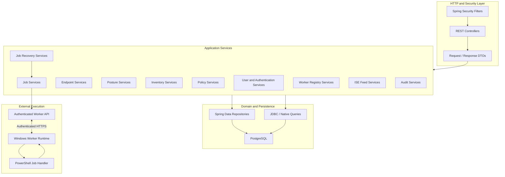

### 5.1 Domain responsibilities

| Domain | Responsibility |
|---|---|
| Authentication and RBAC | User authentication, roles and access decisions |
| Endpoint management | Endpoint records and endpoint lifecycle |
| Posture assessment | Assessment state, compliance evaluation and results |
| Inventory management | Hardware/software inventory and history |
| Policy management | Policy configuration and policy evaluation inputs |
| Job orchestration | Job creation, assignment, claims and status transitions |
| Worker registry | Worker enrollment, identity, shard and heartbeat state |
| ISE feed integration | ISE-related feed ingestion and sharing workflows |
| Audit and reporting | Audit events, history and operational reporting |
| Lease and recovery | Lease renewal, expiry handling and recovery events |

## 6. Worker job lifecycle

The job lifecycle is central to the distributed execution model. The sequence below describes the intended interaction.

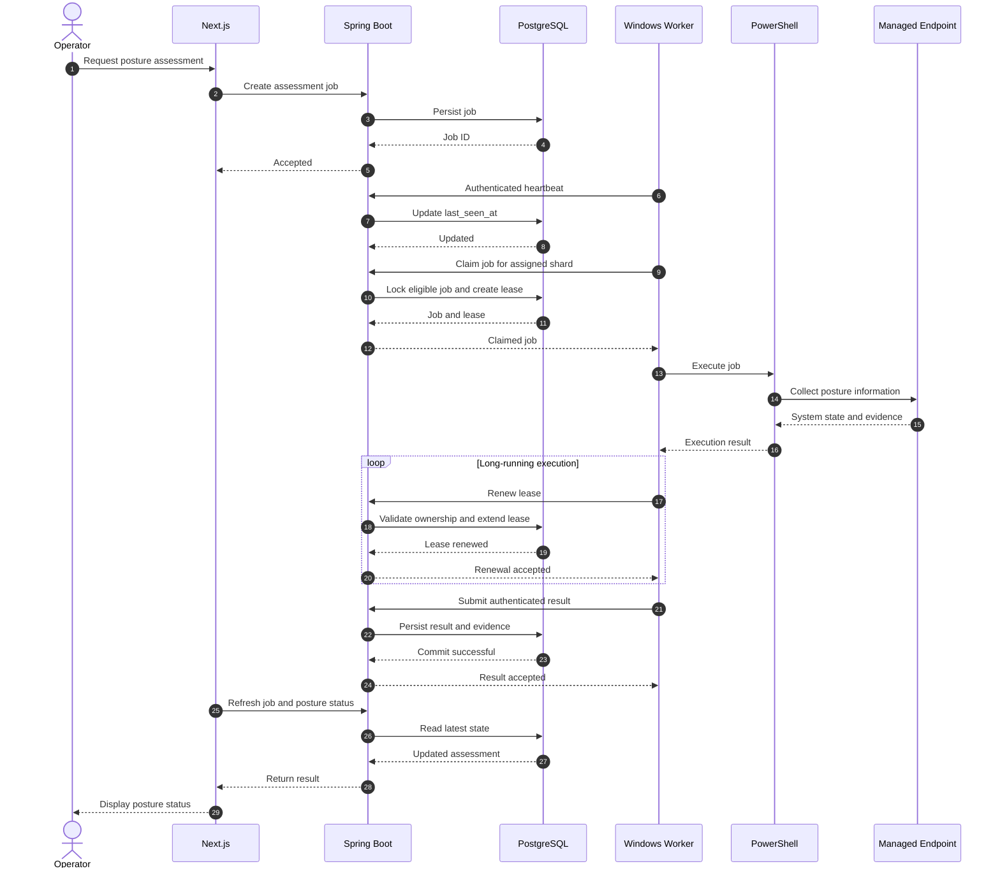

### 6.1 Reliability and correctness requirements

- Worker authentication must be independent from dashboard-user authentication.
- Workers must be restricted to their assigned shard.
- Job claiming must prevent multiple workers from acquiring the same active lease.
- Lease renewal must validate current ownership.
- Lease fencing must prevent stale workers from committing results after ownership changes.
- Result delivery should be safe against retries and duplicate submissions.
- Recovery logic must handle expired leases and interrupted workers.
- Job and recovery events should remain auditable.

## 7. Conceptual data model

The ER diagram below is conceptual. It is not a verified reproduction of every current Flyway migration, table or foreign key. Reconcile exact names, key types, join tables and relationships against the repository migrations before using it as a database LLD or generating schema changes.

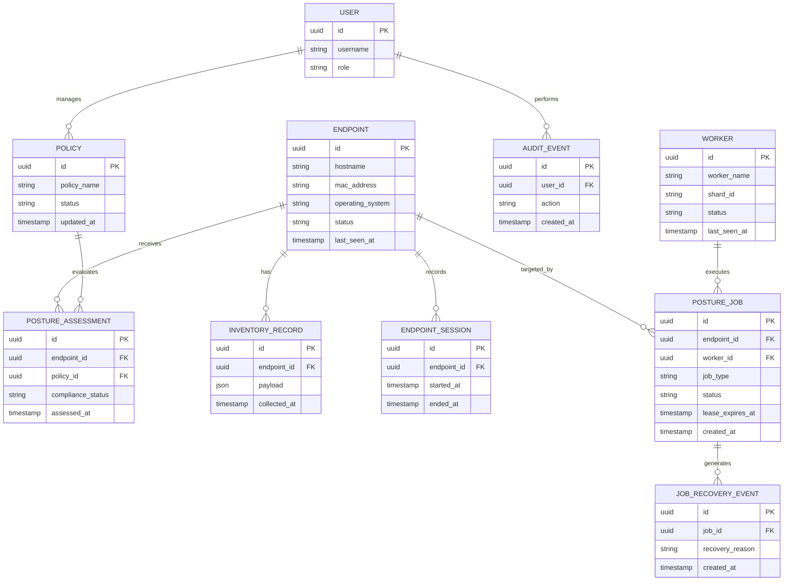

## 8. AWS deployment architecture

### 8.1 Recommended compute and hosting decision

**Decision:** Use Amazon ECS with AWS Fargate for the Linux Spring Boot backend, and Amazon ECR as the container image registry.

| AWS service | Responsibility |
|---|---|
| Amazon ECS | Orchestrates backend container service and task definitions |
| AWS Fargate | Runs backend containers without user-managed EC2 container hosts |
| Amazon ECR | Stores versioned backend Docker images |
| Application Load Balancer | Routes HTTPS requests to the backend service |
| AWS Certificate Manager | Manages TLS certificates for the ALB |
| Amazon RDS for PostgreSQL | Managed relational database |
| Windows EC2 | Runs the Windows Java worker service and PowerShell execution |
| Amazon CloudWatch | Logs, metrics, dashboards and alarms |
| AWS Secrets Manager | Stores runtime secrets |
| AWS KMS | Encryption key management |
| IAM | Permissions for ECS tasks, deployment and other AWS resources |
| VPC | Network isolation and routing |

### 8.2 Deployment diagram

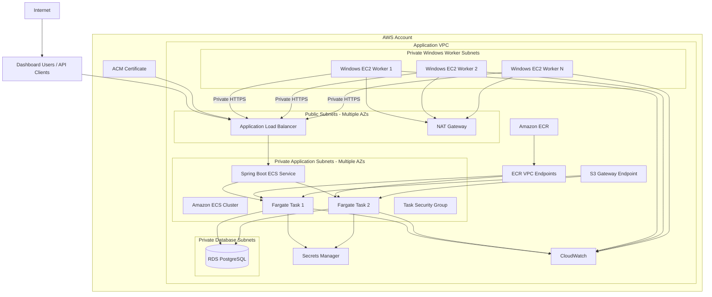

**Network deployment detail:** The supplied logical diagram shows one Application Load Balancer and TLS termination point for user/API and authenticated worker traffic. In the production implementation, decide whether this is one ALB with appropriately separated listeners, hostnames and security controls, or separate public and private ALBs. If separate ALBs are selected, treat that as a physical network refinement of the logical diagram, not a change to the application service boundaries. Workers should use a private ingress path where the VPC topology supports it.

### 8.3 Fargate and networking notes

- Fargate tasks use `awsvpc` networking and have their own network interfaces.
- Configure the ALB target group with target type `ip`, not `instance`, for Fargate tasks.
- Place Fargate tasks in private subnets and do not assign public IP addresses.
- Provide image-pull connectivity to ECR. This can use ECR interface VPC endpoints and an S3 gateway endpoint, or a suitable NAT route.
- Restrict database ingress to the backend task security group.
- Use security groups to allow only required service-to-service paths.
- Spread production tasks across Availability Zones.
- Start with one task in a cost-conscious development environment; consider two or more tasks across Availability Zones for production availability.
- Confirm Fargate CPU/memory combinations, regional availability, quotas and cost before final sizing.

### 8.4 ECS Fargate versus ECS on EC2

| Consideration | ECS + Fargate | ECS + EC2 |
|---|---|---|
| Host management | AWS manages underlying compute | Customer manages EC2 container hosts |
| Scaling | Task-level scaling | Host capacity and task scaling |
| Infrastructure maintenance | Lower | Higher |
| Host-level control | Limited | Greater |
| Initial operations | Simpler | More involved |
| Cost at sustained high utilization | May be higher | May be lower |
| Fit for Spring Boot API | Strong | Strong |

Fargate is the recommended starting point because it reduces host administration. It is not guaranteed to be the lowest-cost choice at every utilization level. Re-evaluate ECS on EC2 or other supported compute options if utilization becomes consistently high and measured cost justifies the added operational work.

**Windows worker decision:** Keep the existing Windows worker runtime on Windows EC2 initially. Although Windows containers are supported in some AWS container configurations, moving this Java/WinSW/PowerShell worker runtime into containers should be a separate, tested design decision.

## 9. Container image and CI/CD architecture

### 9.1 Release pipeline

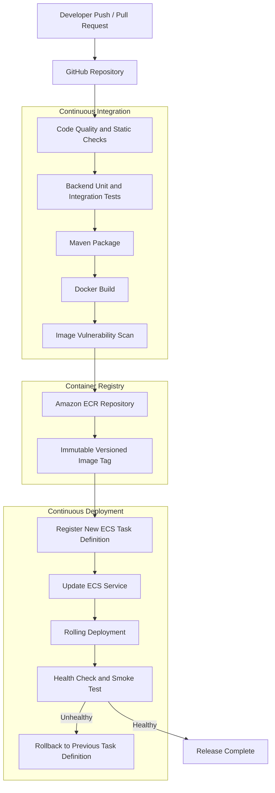

### 9.2 Recommended release conventions

| Area | Recommendation |
|---|---|
| ECR repository | `endpoint-posture-backend` |
| Image tags | Git commit SHA and release version |
| Production deployment reference | Immutable image digest |
| Runtime | ECS Fargate service |
| Deployment unit | ECS task definition revision |
| Health checks | Spring Boot Actuator and ALB target health |
| Logs | CloudWatch Logs |
| Deployment identity | GitHub Actions OIDC role |
| Runtime secrets | AWS Secrets Manager |
| Rollback | Previous known-good task definition and image |

Avoid deploying only with a mutable `latest` tag. Commit-SHA tags and image digests improve traceability and rollback safety.

### 9.3 Deployment behavior

1. A pull request runs checks and tests.
2. A merge to the deployment branch builds the backend artifact and Docker image.
3. The image is scanned according to the project's security policy.
4. GitHub Actions authenticates to AWS using OIDC.
5. The image is pushed to ECR.
6. A new ECS task definition revision references the immutable image.
7. The ECS service is updated.
8. Health checks and smoke tests verify the rollout.
9. If the deployment is unhealthy, the pipeline or operator restores the previous known-good task definition.

## 10. Security architecture

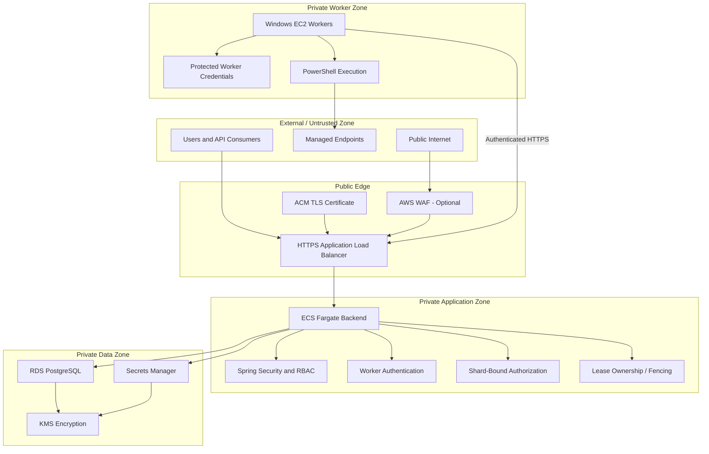

### 10.1 Security controls

1. Public user and API traffic uses HTTPS.
2. Spring Security enforces authentication and role-based authorization.
3. Workers authenticate independently from dashboard users.
4. Worker identity and shard assignment constrain job claims and result submission.
5. Lease fencing prevents stale workers from committing after ownership changes.
6. Database ingress is restricted to the application security group.
7. Secrets are not embedded in images, source control or plaintext configuration.
8. Windows worker credentials use the runtime's protected credential mechanism.
9. IAM roles follow least privilege for ECS tasks, CI/CD and infrastructure.
10. Encryption at rest and in transit is configured for data stores and service communications.
11. Audit events capture security-sensitive administrative and worker operations.

## 11. Scaling and observability

### 11.1 Scaling model

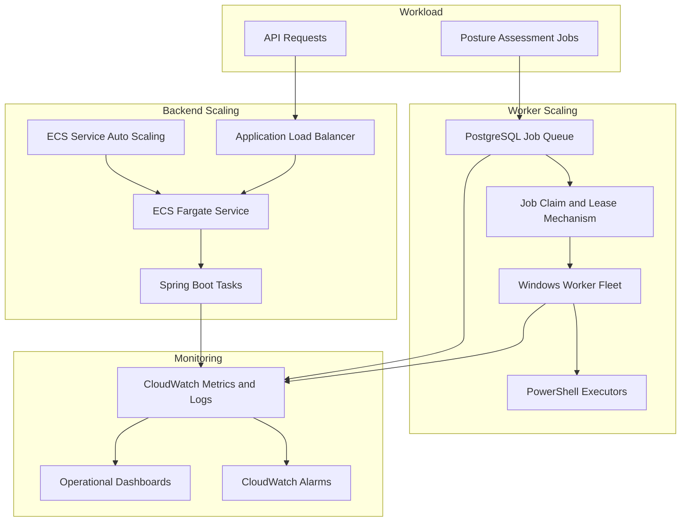

Backend API scaling does not automatically increase endpoint assessment throughput. Windows workers execute the assessments. Treat backend task scaling and worker fleet scaling as separate capacity decisions.

### 11.2 Operational metrics

For a 50,000-endpoint simulation and subsequent scale testing, measure:

- Jobs completed per minute.
- Average and p95 job execution duration.
- Queue depth and age of the oldest queued job.
- Worker utilization and stale-worker count.
- Lease expiration and recovery rate.
- Result submission success and retry rate.
- API request rate, latency and error rate.
- Fargate CPU and memory utilization.
- PostgreSQL connection utilization, query latency and storage growth.
- ALB target health and request metrics.

### 11.3 Scaling responsibilities

| Component | Scaling mechanism |
|---|---|
| Spring Boot API | ECS service desired task count |
| Fargate tasks | CPU, memory and request metrics |
| Windows workers | Number of Windows EC2 worker instances |
| Job throughput | Worker count, shard distribution and job duration |
| Database | RDS sizing, connection management and query optimization |
| Observability | CloudWatch metrics, logs, dashboards and alarms |

## 12. Current implementation versus target architecture

The architecture documentation must distinguish verified implementation from planned AWS infrastructure and future integrations.

| Component | Status to document |
|---|---|
| Spring Boot backend | Implemented; latest supplied audit reported backend verification passing |
| PostgreSQL persistence | Implemented in the application |
| Job leasing and recovery | Implemented in the application |
| Authenticated worker APIs | Implemented in the application |
| Windows Java worker runtime | Separate implementation and deployment work; verify current release state |
| Next.js dashboard | Existing frontend; further work planned |
| ECS Fargate backend hosting | Target deployment |
| ECR image registry | Target deployment |
| AWS ALB and VPC | Target infrastructure |
| RDS PostgreSQL | Target managed database deployment |
| CloudWatch integration | Target operational monitoring |
| Cisco ISE live connectivity | Future integration; connectivity dependent |
| Redis / Grafana | Optional future additions; not assumed in the baseline |

The project audit supplied for this design reported 595 backend tests passing, but also identified remaining API compatibility, query performance and selective integration reviews. A passing test suite does not by itself mean the candidate changes have been integrated into the main branch or deployed to AWS.

## 13. Terraform repository structure

Suggested modular structure:

```text
terraform/
├── environments/
│   ├── dev/
│   ├── staging/
│   └── production/
│
├── modules/
│   ├── networking/
│   │   ├── vpc
│   │   ├── subnets
│   │   ├── route-tables
│   │   └── security-groups
│   │
│   ├── container-registry/
│   │   └── ecr
│   │
│   ├── compute/
│   │   ├── ecs-cluster
│   │   ├── ecs-service
│   │   └── fargate-task
│   │
│   ├── load-balancing/
│   │   └── alb
│   │
│   ├── database/
│   │   └── rds-postgresql
│   │
│   ├── workers/
│   │   └── windows-ec2-fleet
│   │
│   ├── security/
│   │   ├── iam
│   │   ├── secrets-manager
│   │   └── kms
│   │
│   └── monitoring/
│       ├── cloudwatch
│       └── alarms
│
└── main.tf
```

This is a proposed structure. Align it with the existing Terraform repository before creating or moving modules.

## 14. Architecture implementation roadmap

1. **Finalize HLD:** Approve boundaries, responsibilities, security model and ECS/Fargate decision.
2. **Build backend container:** Create Dockerfile, health checks, non-root runtime, image build and local container verification.
3. **Provision ECR and ECS Fargate:** Create registry, cluster, task definition, service, IAM roles and networking.
4. **Provision and connect RDS:** Configure database, migrations, secrets, security groups and connection pooling.
5. **Automate deployment:** Configure GitHub Actions OIDC, ECR publishing and ECS deployment.
6. **Connect Windows workers:** Establish private connectivity, authentication, job processing, lease renewal and result delivery.
7. **Scale and observe:** Run load tests, configure CloudWatch, alarms, worker scaling and the 50k endpoint simulation.

## 15. Decisions and open questions

### Decisions recommended by this HLD

- Use ECS with Fargate for the Linux Spring Boot backend.
- Use ECR for backend container images.
- Keep Windows worker execution on Windows EC2 initially.
- Use RDS PostgreSQL for the AWS managed database target.
- Put backend tasks in private subnets.
- Use ALB for HTTP ingress and health-based routing.
- Prefer separate public-user and private-worker ingress paths in production.
- Use GitHub Actions OIDC for deployment identity.
- Scale backend tasks independently from Windows workers.

### Items requiring validation before production

- ECS task CPU and memory sizing.
- Fargate service desired count and autoscaling thresholds.
- ALB topology, worker ingress and DNS design.
- VPC CIDRs, subnet sizing, NAT and VPC endpoint costs.
- RDS instance class, storage, backup, Multi-AZ and connection limits.
- ECR lifecycle and image scanning policies.
- GitHub Actions deployment permissions and environment approvals.
- Windows worker fleet sizing and endpoint network reachability.
- Cisco ISE connectivity and security requirements.
- API pagination compatibility and database query plans.
- Actual Terraform module boundaries and existing infrastructure state.

## 16. References

AWS documentation to consult during implementation:

- Amazon ECS: https://docs.aws.amazon.com/AmazonECS/latest/developerguide/Welcome.html
- AWS Fargate: https://docs.aws.amazon.com/AmazonECS/latest/developerguide/AWS_Fargate.html
- ECS task networking: https://docs.aws.amazon.com/AmazonECS/latest/developerguide/task-networking.html
- ECS load balancing: https://docs.aws.amazon.com/AmazonECS/latest/developerguide/service-load-balancing.html
- Amazon ECR: https://docs.aws.amazon.com/AmazonECR/latest/userguide/what-is-ecr.html
- ECS service autoscaling: https://docs.aws.amazon.com/AmazonECS/latest/developerguide/service-auto-scaling.html
- GitHub Actions OIDC with AWS: https://docs.aws.amazon.com/IAM/latest/UserGuide/id_roles_providers_create_oidc.html

---

**Document classification:** Architecture proposal / engineering design  
**Next artifact:** Low-Level Design (LLD) derived from verified source packages, Flyway migrations, worker runtime and Terraform modules.

---

# Part II. Low-Level Design (LLD)

> **LLD baseline and evidence boundary**  
> Repository: `devbhargav10/Endpoint-Posture-Java`  
> Branch: `main`  
> Commit inspected: `3d17d10551e54caebe52a6bda0ba5fb4d88315e1`  
> Baseline date: 18 November 2026  
> Backend: Java 21, Spring Boot 3.5.16, Maven, PostgreSQL, Flyway  
> Worker: independent Java 21 Maven application, Windows service packaging, PowerShell execution, SQLite result outbox  
> Frontend: Next.js 16, React 19, TypeScript, Vitest
>
> This section documents the repository's `main` branch as inspected. It does not silently merge local worktree-only changes into the baseline. In particular, the local pagination integration candidate described in the 18 November audit contains an additional `V33__history_page_indexes.sql` migration and wider API/UI pagination edits; **V33 is not part of the inspected `main` tree**, whose checked-in migrations end at V32. Keep that candidate separate until its compatibility, query-plan and frontend verification are accepted and merged.
>
> The LLD is source-informed, but it is not a generated class-by-class API reference. Where a method contract or schema detail has not been verified from the source files, it is explicitly marked for confirmation rather than invented.

## 17. LLD scope and system decomposition

The project is a modular Spring Boot application with a separate Windows worker executable and a Next.js dashboard. The backend is the authoritative control plane and persistence boundary. The worker is an independently deployed execution-plane process. The frontend is a browser client and does not connect directly to PostgreSQL or Cisco ISE.

### 16.1 Repository modules

| Repository path | Responsibility | Runtime / build |
|---|---|---|
| `backend/` | REST API, domain services, scheduling, security, PostgreSQL persistence, ISE integrations | Java 21, Spring Boot 3.5.16, Maven |
| `worker-runtime/` | Worker enrollment, lifecycle, backend HTTP client, PowerShell execution, durable result outbox | Java 21, Maven shaded executable |
| `frontend/` | Operator dashboard, login/session state, API client, data hooks and page components | Next.js 16, React 19, TypeScript, Vitest |
| `deploy/` | Windows worker installation, service configuration, service account and credential scripts | PowerShell, WinSW XML, Caddy proxy config |
| `terraform/` | Infrastructure-as-code foundation; checked-in modules include network and PostgreSQL | Terraform |
| `.github/workflows/` | CI and Terraform workflow definitions | GitHub Actions |
| `docker-compose.yml`, Dockerfiles | Local/container development and image build definitions | Docker |
| `docs/`, `Doc/` | Design, handoff, operations and project documentation | Markdown and supporting assets |

### 16.2 Backend package map

The main backend package is `com.endpointposture`.

| Package | Primary responsibility | Key source types |
|---|---|---|
| root | Spring application bootstrap and scheduling configuration | `EndpointPostureApplication`, `SchedulingConfiguration` |
| `api` | Shared API paging primitives | `ApiPaging` |
| `audit` | ISE action audit read model and repository | `AuditQueryController`, `IseActionAudit`, `IseActionAuditRepository` |
| `dashboard` | Dashboard aggregates, trends and rollups | `DashboardController`, `DashboardService`, `DashboardRepository`, `TrendRollupScheduler` |
| `diagnostic` | Diagnostic evidence ingestion, scoring and history | `DiagnosticIngestController`, `DiagnosticQueryController`, `DiagnosticService`, `DiagnosticScorer` |
| `endpoint` | Endpoint identity, list/detail APIs and query services | `Endpoint`, `EndpointController`, `EndpointService`, `EndpointQueryService`, `EndpointRepository` |
| `hardware` | Hardware health ingestion, scoring, recommendations and fleet queries | `HardwareIngestController`, `HardwareQueryController`, `HardwareHealthService`, component scorers |
| `indicator` | Security indicator ingestion, finding analysis and history | `SecurityIndicatorIngestController`, `SecurityIndicatorQueryController`, `SecurityIndicatorService`, `SecurityIndicatorAnalyzer` |
| `inventory` | Software/application and port inventory, paged queries and retention | `EndpointInventory`, `InventoryController`, `InventoryPageController`, `InventoryRetentionService` |
| `ise` | ISE enforcement/share operations, transport, status and durable recovery | `IseActionController`, `IseActionService`, `ErsIseTransport`, `IseOperationStore`, `IseOperationRecoveryScheduler` |
| `isefeed` | ISE pull feed and versioned sharing rule | `IseFeedController`, `IseFeedService`, `SharingRuleService` |
| `job` | Job lifecycle, scheduling, local execution, queue metrics and recovery | `JobController`, `JobService`, `PostureJobRepository`, `JobWorkerPool`, `RecheckScheduler`, `StaleJobRecoveryScheduler`, `JobRecoveryService` |
| `policy` | Versioned required/blocked application policy | `PolicyController`, `PolicyService`, `AppPolicy`, repositories |
| `posture` | Posture report ingestion, assessment/check persistence and read APIs | `PostureIngestController`, `PostureIngestService`, `AssessmentService`, `AssessmentRepository` |
| `retention` | Evidence retention scheduling and pruning | `EvidenceRetentionScheduler`, `EvidenceRetentionService` |
| `security` | User login, JWT, agent/ISE authentication filters, XML hardening and security headers | `SecurityConfig`, `JwtAuthFilter`, `JwtService`, `PostureApiKeyFilter`, `IseFeedAuthFilter`, `SecureXml` |
| `session` | ISE active-session polling, event persistence and reconnect detection | `IseSessionClient`, `IseSessionWatcher`, `SessionBatchWriter`, `SessionQueryController` |
| `sim` | Simulated endpoint identities, agents and ISE sessions for load/testing | `SimulatedAgentRunner`, `SimulatedIseSessionClient`, `SimReporter` |
| `system` | Runtime health and operational state | `SystemHealthController`, `SystemHealthService` |
| `warranty` | Warranty CSV import, parsing, persistence and query | `WarrantyController`, `WarrantyService`, `WarrantyRecordRepository` |
| `worker` | Remote worker enrollment, authentication, shard claim, leases and result delivery | `WorkerController`, `WorkerAdminController`, `WorkerAuthFilter`, `WorkerJobService`, `WorkerResultService` |

### 16.3 Component dependency diagram

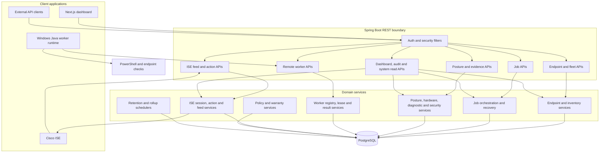

## 18. Backend application design

### 17.1 Bootstrap and configuration

`EndpointPostureApplication` is the Spring Boot entry point. It enables configuration-properties groups for posture, hardware, diagnostics, security indicators and ISE. `SchedulingConfiguration` supplies scheduling-related configuration. Runtime settings are externalized in `application.yml`, with Linux and simulation overlays in `application-linux.yml` and `application-sim.yml`.

The backend Maven project uses Java 21 and Spring Boot 3.5.16. Important dependencies include Spring Web, Validation, Spring Data JPA, PostgreSQL JDBC, Flyway core plus PostgreSQL support, Spring Security, JJWT, springdoc OpenAPI, Actuator, Micrometer Prometheus, Lombok and Testcontainers.

Configuration rules:

- Keep secrets outside committed YAML and container layers. Supply them through environment variables or the target secret store.
- Use UTC for persisted timestamps and worker lease calculations.
- Keep Linux execution profile separate from Windows worker execution. The Linux API does not need a local PowerShell process to serve remote workers.
- Validate ISE TLS configuration at startup. Do not silently disable certificate verification in a production profile.
- Keep simulation-only settings in the simulation profile and do not mistake simulated ISE sessions for a live ISE connection.

### 17.2 Request handling and service boundary

The normal backend request path is:

1. Servlet filters establish the caller identity or reject the request.
2. Spring Security applies URL-level access rules.
3. Controller validates path, query and request-body inputs and maps the HTTP contract.
4. A domain service performs orchestration and transaction demarcation.
5. A repository or `JdbcTemplate` query accesses PostgreSQL.
6. DTOs are returned to the caller. JPA entities should not be exposed directly as public API contracts.

Controllers are grouped by domain rather than by technical operation. Services contain business rules and repositories own database access. Some concurrency-sensitive operations use native PostgreSQL SQL through repository methods or `JdbcTemplate` because row locking, `SKIP LOCKED`, partial unique indexes and `RETURNING` are important to correctness.

### 17.3 Backend service interaction diagram

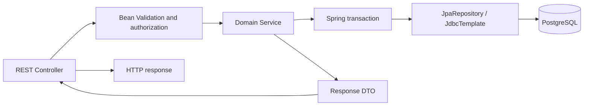

### 17.4 Endpoint and inventory domain

`Endpoint` is the canonical managed-device identity. The repository supports lookup and query operations. `EndpointService` handles write-side endpoint operations, while `EndpointQueryService` supplies list/detail read models. The API uses UUIDs internally and exposes endpoint attributes such as MAC address, IP address, hostname, OS name/version, connection state and last-seen timestamp.

Inventory is stored as historical endpoint inventory data, with `EndpointInventoryRepository` and `InventoryQueryService` supporting reads. The repository contains a retention scheduler/service and pointer/index support for efficient latest-inventory access. Application and port views are derived from inventory payloads rather than being separate browser-side databases.

### 17.5 Posture assessment domain

The posture ingestion boundary is `PostureIngestController` at `POST /api/v1/posture`. It accepts a `PostureReportRequest`, delegates to `PostureIngestService`, and persists an assessment plus check results. The read side is intentionally separate: `PostureQueryController` exposes endpoint assessment history and latest assessment routes.

Assessment statuses represented in the frontend contract are `COMPLIANT`, `NON_COMPLIANT` and `ERROR`. A check result carries a check type, status, optional structured details and creation time. The latest-assessment path may return `204 No Content` when no assessment exists.

### 17.6 Hardware health domain

`HardwareIngestController` and `HardwareIngestService` accept hardware reports. Component scorers include CPU, memory, storage, battery and generic component scoring. `HardwareHealthService` persists the health result and recommendations. `HardwareQueryController` and `HardwareFleetController` provide per-endpoint and fleet-level reads.

The public read model includes component scores, overall score and band, collection time, success/failure state, failure diagnostics, warranty context and recommendations. Bands include `HEALTHY`, `WARNING`, `DEGRADED` and `CRITICAL` in the frontend type contract.

### 17.7 Diagnostics and security indicators

The diagnostics domain ingests diagnostic reports, evaluates them with `DiagnosticScorer`, and stores structured result evidence. The security-indicator domain ingests security reports, runs `SecurityIndicatorAnalyzer`, and persists findings, summary and risk level. Both domains expose endpoint history/latest read APIs and associate evidence with the originating job where supplied.

### 17.8 Policy and warranty domains

`PolicyService` manages versioned application policy, including required and blocked applications. Policy reads are available to application clients; mutation is ADMIN-only. `WarrantyService` parses uploaded CSV data, reports saved row counts and row-level errors, and exposes warranty status, vendor, expiration and remaining-day information. Warranty upload is ADMIN-only.

## 19. Job orchestration and execution design

### 18.1 Job domain model

`PostureJob` is the durable unit of work. Job types in the frontend contract are:

- `POSTURE_CHECK`
- `HARDWARE_CHECK`
- `DIAGNOSTIC_CHECK`
- `SECURITY_CHECK`

Lifecycle states are `QUEUED`, `RUNNING`, `COMPLETE` and `FAILED`. A job includes endpoint association, priority, attempt count, maximum attempts, timestamps, error details, shard and (for remote execution) claimant and lease expiry. Manual jobs default to priority 10; automatic jobs use priority 0. The configured/default maximum attempts in the enqueue path is three.

### 18.2 Enqueue rules

`JobController` exposes manual single-endpoint enqueue and bulk enqueue. `JobService` owns enqueue and scheduling rules:

- A job is not added if the same endpoint and job type already has a `QUEUED` or `RUNNING` job.
- A partial unique index arbitrates this invariant across concurrent API replicas.
- Bulk enqueue is a single `INSERT ... SELECT` for connected endpoints with a usable target, excluding endpoints that already have an active job of the same type.
- Reconnect-triggered work observes a minimum-gap setting to avoid rechecking every reconnect.
- Timed rechecks use the last completed job and recent failure/backoff state to avoid unnecessary work and retry storms.

### 18.3 Claiming and concurrency

The repository uses PostgreSQL `SELECT ... FOR UPDATE SKIP LOCKED` to claim one eligible queued job. Jobs are ordered by descending priority and then oldest creation time. Remote worker claims add a shard predicate. The claim operation must execute inside a transaction so the row lock protects the transition.

The `attempt_count` is the fencing token. Each new attempt increments it. A worker must present its authenticated identity and the attempt number when renewing, completing, failing or submitting a result. A stale worker from an older attempt cannot change the current job.

### 18.4 Job sequence diagram

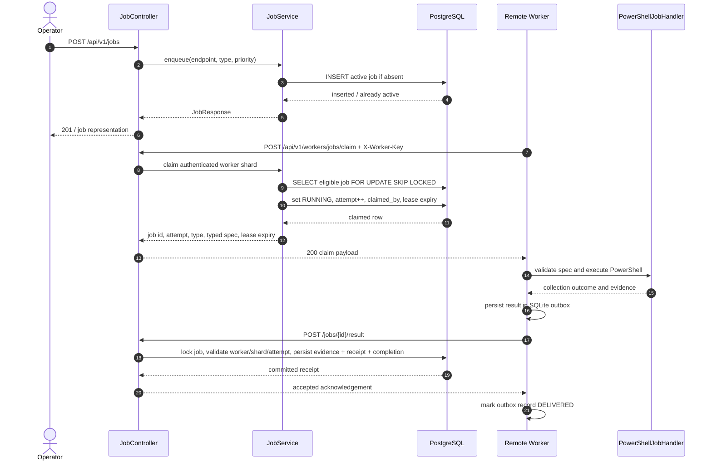

### 18.5 Lease renewal and stale recovery

The default remote lease is configured through `app.workers.lease-seconds` (the source default is 300 seconds). The maximum extension is configured through `app.workers.max-lease-extension-seconds` (source default 900 seconds). Renewal is accepted only if the job is still `RUNNING`, the authenticated worker owns it, the attempt number matches and the existing lease has not expired. The expiry is advanced with `GREATEST`, so it cannot move backwards.

Expired remote leases and stale embedded/local executions are treated separately. Remote jobs have an explicit lease expiry. Local jobs have no remote lease and are recovered using their `started_at` age/cutoff. Recovery updates are fenced by the attempt number and, for remote work, by the lease-expired predicate. A renewal racing with a recovery sweep wins if it updates the lease before the recovery write predicate is evaluated.

`JobRecoveryService` records durable recovery events. V27 creates the recovery event table and V28 preserves audit history when referenced operational rows are deleted. `JobRetentionScheduler` and related retention services prune eligible completed work without erasing the evidence/audit history that must remain.

### 18.6 Job state machine

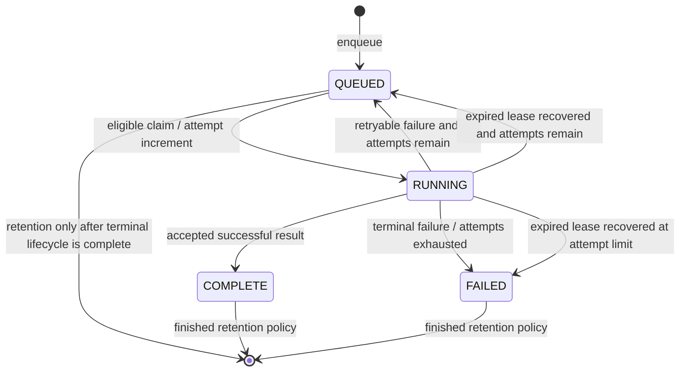

### 18.7 Queue and scheduler responsibilities

| Component | Responsibility |
|---|---|
| `JobService` | Enqueue, deduplicate, claim, retry timing, complete/fail fencing and list queries |
| `PostureJobRepository` | Atomic inserts, row locks, shard-aware claims, fenced updates, stale discovery and bounded reads |
| `JobSpecFactory` | Convert a persisted job and endpoint into a typed execution specification |
| `JobWorkerPool` / `JobWorker` | Existing embedded/local execution path, depending on configured execution mode |
| `RecheckScheduler` | Determine which endpoints are due for periodic posture/hardware checks |
| `StaleJobRecoveryScheduler` | Find and recover stale running jobs |
| `JobRecoveryService` | Apply recovery and preserve recovery history |
| `JobRetentionScheduler` | Remove old finished job rows according to retention policy |
| `JobQueueMetrics` | Expose queue counts and operational metrics |

## 20. Remote worker runtime LLD

### 19.1 Worker process structure

`worker-runtime` is a separate Maven project and shaded Java 21 executable. Its source is divided into:

- Root lifecycle/bootstrap: `WorkerMain`, `WorkerBootstrap`, `WorkerConfig`, `WorkerLifecycle`.
- Backend transport: `WorkerApiClient`, response/request records, typed API/transport exceptions.
- Credential protection: `CredentialStore`, `DpapiSecretProtector`, `SecretProtector`, `StoredCredentials`.
- Execution: `JobSpecParser`, `ValidatedJob`, `PowerShellExecutionConfig`, `PowerShellExecutor`, `PowerShellJobHandler`.
- Result durability: `CompletedJobResult`, `JobResultHandoff`, `SqliteJobResultHandoff`, `PersistedJobResult`, `ResultDispatcher`, `OutboxStatistics`.

`deploy/` contains scripts and service XML for provisioning the worker service, configuring the service account and ACLs, preparing the deployment, setting secrets, installing/removing/starting/stopping the service and testing deployment. WinSW is used to host the Java process as a Windows service.

### 19.2 Enrollment and credential lifecycle

1. An administrator creates a named worker and shard through the ADMIN-only worker administration API.
2. The backend stores a hash of a short-lived, single-use enrollment token. The token is displayed once.
3. The worker redeems the token at `POST /api/v1/workers/enroll`.
4. The backend atomically marks the token redeemed, creates a worker registry row, stores only a hash of the generated worker API key and returns the key once.
5. The worker stores credentials through `CredentialStore` and `DpapiSecretProtector`; DPAPI protects the secret using the Windows security context.
6. The worker uses `X-Worker-Key` on worker API calls. `X-Worker-Api-Key` is an accepted alias on the backend; `X-Worker-Key` takes precedence if both are supplied.
7. An administrator can revoke a worker. Disabled/revoked keys stop authenticating immediately.

### 19.3 Worker lifecycle and polling

The runtime performs startup validation, loads protected credentials, constructs the authenticated API client, starts its durable result dispatcher and enters the worker lifecycle. The API client calls the backend over HTTP(S), applies request timeouts, limits response bytes, parses typed responses and maps HTTP failures into typed exceptions.

The worker periodically sends a heartbeat. The backend derives `ACTIVE`, `STALE` or `REVOKED` from the enabled flag and `last_seen_at`; this status is derived at read time rather than stored as a separate state that could become stale. Source defaults are a 30-second heartbeat interval and a 90-second stale threshold. A worker claims only jobs in its assigned shard.

### 19.4 Result envelope and durable outbox

The worker validates the job specification before execution. The PowerShell executor applies the configured executable, arguments, timeout and output constraints. `PowerShellJobHandler` converts process exit information and the agent's output contract into a result envelope with:

- `schemaVersion` (currently supported value 1)
- `jobType`
- `collectionOutcome` (`SUCCESS`, `PARTIAL` or `FAILED`)
- `reportPayload`
- `errors` and `warnings`
- `processExitCode`
- attempt identity

Before attempting result delivery, the worker persists the completed result into a local SQLite outbox. The outbox uses WAL mode, `synchronous=FULL`, foreign-key enforcement, a schema version, an immutable payload identity/hash, and guarded state transitions. The logical uniqueness key is `(job_id, attempt)`. A process restart can therefore resume delivery without re-running the endpoint collection or mutating the submitted result bytes.

`ResultDispatcher` sends the exact stored request bytes. It uses bounded exponential backoff with jitter, honours `Retry-After` for rate limits, renews a lease within a durable cumulative extension budget while the delivery grace window remains open, and marks the row delivered only after validating the backend acknowledgement. A stale/conflicting response or other permanent client error is retained as `PERMANENT_FAILURE` for operator review; retryable transport, timeout and server failures remain pending.

### 19.5 Worker lifecycle sequence

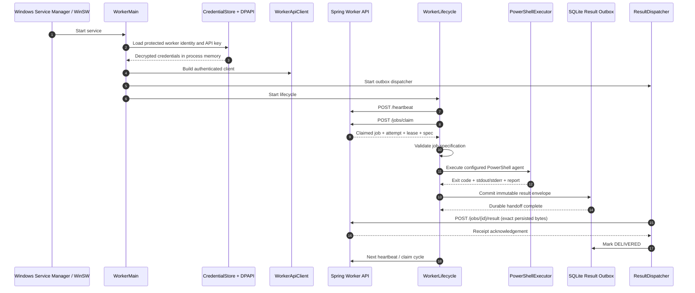

### 19.6 Worker failure handling

| Failure | Expected handling |
|---|---|
| Invalid/expired enrollment token | Enrollment rejected; no worker credential is issued |
| Revoked or unknown worker key | Backend returns 401 and records an authentication event |
| Worker API throttling | Client receives 429 and observes `Retry-After` where provided |
| No eligible job | Claim returns 204; worker remains healthy and polls again |
| Invalid job spec | Job is not executed; failure is reported through the fenced failure path |
| PowerShell timeout/non-zero result | Handler creates a failure/partial result according to the output contract |
| Backend unavailable after collection | Result remains durable in SQLite and dispatcher retries |
| Worker process restart | Startup reopens the outbox and resumes pending deliveries |
| Lease expires before result acceptance | Backend rejects stale attempt with 409; worker does not overwrite a newer attempt |
| SQLite persistence failure | Worker blocks further unsafe progress and emits critical diagnostics; in-memory-only results are not treated as durable |
| Permanent result rejection | Result is retained for operator investigation, not silently discarded |

## 21. Worker and backend API contracts

The following table lists the important routes verified in the current source. It is a selected contract inventory, not a substitute for generated OpenAPI. Payload fields shown here are the stable fields visible in controller records and service contracts.

| Method | Route | Caller / purpose | Request or response notes |
|---|---|---|---|
| POST | `/api/v1/auth/login` | User login | Username/password; returns JWT, username and role |
| GET | `/api/v1/endpoints` | Authenticated UI/API | Bounded endpoint list; legacy list contract retained |
| GET | `/api/v1/endpoints/page` | Authenticated UI/API | Zero-based page, size and supported filters; `PageResponse<T>` shape |
| GET | `/api/v1/endpoints/{id}` | Authenticated UI/API | Endpoint detail |
| GET | `/api/v1/endpoints/{id}/posture` | Authenticated UI/API | Assessment history |
| GET | `/api/v1/endpoints/{id}/posture/latest` | Authenticated UI/API | Latest assessment; 204 when absent |
| POST | `/api/v1/posture` | AGENT or ADMIN | Posture report ingestion |
| GET | `/api/v1/hardware-health/page` | Authenticated UI/API | Paged fleet hardware read model |
| POST | `/api/v1/hardware-health` | AGENT or ADMIN | Hardware report ingestion |
| POST | `/api/v1/diagnostics` | AGENT or ADMIN | Diagnostic report ingestion |
| POST | `/api/v1/security-indicators` | AGENT or ADMIN | Security indicator ingestion |
| POST | `/api/v1/jobs` | ADMIN, OPERATOR or ANALYST | Enqueue one endpoint job; manual priority defaults to 10 |
| POST | `/api/v1/jobs/bulk` | ADMIN, OPERATOR or ANALYST | Enqueue selected job type for connected endpoints |
| GET | `/api/v1/jobs` | Authenticated UI/API | Bounded recent jobs; default 200, max 1000 in controller |
| GET | `/api/v1/jobs/page` | Authenticated UI/API | Paged job response |
| POST | `/api/v1/admin/workers/enrollment-tokens` | ADMIN | Create single-use token; token shown once |
| GET | `/api/v1/admin/workers` | ADMIN | List registered workers |
| POST | `/api/v1/admin/workers/{id}/revoke` | ADMIN | Revoke worker credential |
| POST | `/api/v1/workers/enroll` | Unauthenticated, token protected | Redeem one-time token; returns worker ID, name, shard and API key once |
| POST | `/api/v1/workers/heartbeat` | WORKER | Bodyless heartbeat; identity comes from API key |
| POST | `/api/v1/workers/jobs/claim` | WORKER | Claim next eligible job in authenticated worker shard; 204 if empty |
| POST | `/api/v1/workers/jobs/{id}/lease/renew` | WORKER | Attempt plus optional extension seconds; 409 if stale/unowned/expired |
| POST | `/api/v1/workers/jobs/{id}/complete` | WORKER | Attempt number; legacy fenced completion route |
| POST | `/api/v1/workers/jobs/{id}/fail` | WORKER | Attempt and failure reason |
| POST | `/api/v1/workers/jobs/{id}/result` | WORKER | Versioned result envelope; idempotent receipt acknowledgement |
| GET | `/api/v1/integrations/ise/endpoints` | ISE feed credential or ADMIN | ISE feed with page and size; sharing-rule filtered |
| GET | `/api/v1/integrations/ise/sharing-rule` | Authenticated feed/admin context | Current feed sharing rule |
| PUT | `/api/v1/integrations/ise/sharing-rule` | ADMIN | Create next version of sharing rule |
| GET | `/api/v1/ise/actions/state` | Authenticated UI/API | Latest enforcement action state per endpoint |
| POST | `/api/v1/ise/posture/share` | Authorized operator/admin | Request posture sharing with ISE |
| POST | `/api/v1/ise/enforcement/restrict` | Authorized operator/admin | Request restriction action |
| POST | `/api/v1/ise/enforcement/clear` | Authorized operator/admin | Clear restriction action |
| GET | `/api/v1/dashboard/summary` | Authenticated UI/API | Dashboard summary metrics |
| GET | `/api/v1/dashboard/trend` | Authenticated UI/API | Assessment trend series |
| GET | `/api/v1/system/health` | Authenticated UI/API | Database, ISE, queue and worker runtime health |
| GET | `/api/v1/audit/ise-actions` | Authenticated UI/API | ISE action audit history |
| GET/POST/PATCH/DELETE | `/api/v1/users/**` | ADMIN | User administration |
| GET/PUT | `/api/v1/policy/apps` | Authenticated read / ADMIN write | Current application policy and version history |
| GET/POST | `/api/v1/warranty/**` | Authenticated read / ADMIN upload | Warranty list and CSV import |

**Contract notes:**

- The worker API is intentionally separate from user JWT authentication. Worker identity is established by `WorkerAuthFilter` and the `X-Worker-Key` header.
- The ISE feed has a separate authentication filter and can be pulled using the scoped ISE Basic credential or previewed by an ADMIN JWT.
- `PageResponse<T>` has `items`, `total`, `page` and `size` fields.
- The frontend API client stores its user token in `sessionStorage` under `vece_token`, adds `Authorization: Bearer ...`, and clears the session and redirects to `/login` after a 401.
- The exact authorization for every non-worker route is governed by `SecurityConfig` plus controller-level `@PreAuthorize`; consult both when adding a route.

## 22. Authentication and authorization design

### 21.1 Authentication mechanisms

| Principal type | Mechanism | Filter / boundary |
|---|---|---|
| Human dashboard user | Username/password login followed by JWT bearer token | `JwtAuthFilter`, `JwtService` |
| Endpoint agent / ingestion client | Configured posture API key on supported ingestion endpoints | `PostureApiKeyFilter` |
| Cisco ISE feed consumer | HTTP Basic using dedicated feed credentials | `IseFeedAuthFilter` |
| Remote Windows worker | Per-worker API key in `X-Worker-Key` (alias `X-Worker-Api-Key`) | `WorkerAuthFilter` |
| Liveness/readiness probe | Public actuator health routes | Spring Security path matchers |

The backend is stateless at the HTTP session layer. Passwords are BCrypt encoded. Login protection includes failed-attempt lockout and rate limiting. Worker authentication has separate IP-level and per-worker rate limits, and worker result bodies are bounded after authorization.

### 21.2 Human role model

The frontend's user-role union is `ADMIN`, `OPERATOR`, `ANALYST` and `VIEWER`. The backend additionally uses machine roles such as `AGENT`, `ISE_FEED` and `WORKER` for non-human clients. Typical permissions visible in the source include:

- `ADMIN`: user management, worker enrollment/revocation, policy mutation, ISE sharing-rule mutation, warranty upload and administrative actions.
- `OPERATOR` / `ANALYST`: manual job enqueue and operational workflows as allowed by controller rules.
- `VIEWER`: read-only application access.
- `AGENT`: authorized ingestion routes only.
- `ISE_FEED`: authorized ISE feed retrieval only.
- `WORKER`: remote worker routes only. Worker identities are explicitly excluded from general `/api/v1/**` application APIs.

### 21.3 Security sequence

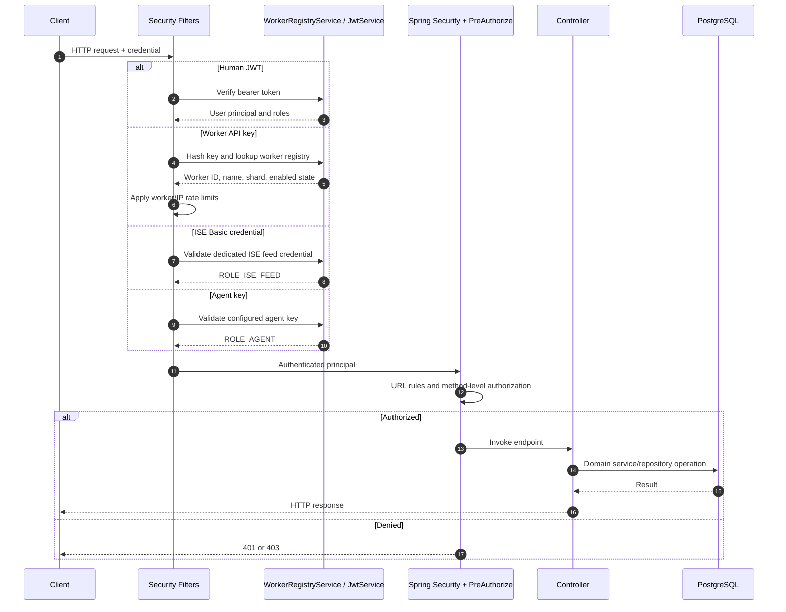

## 23. Worker result acceptance and idempotency

The result endpoint is a transactional boundary. `WorkerResultService` validates the envelope schema version, outcome, payload limits and consistency between process exit code, collection outcome, errors and warnings. It hashes the canonical request and checks for a prior receipt before mutating the job. It then locks the job row and rechecks the receipt to handle concurrent duplicate submissions.

The current attempt must satisfy all of these conditions:

- Job is `RUNNING`.
- `attempt_count` equals the submitted attempt.
- `claimed_by` equals the authenticated worker ID.
- Worker shard equals the job shard.
- Submitted job type equals the persisted job type.
- The result is not a conflicting payload for an already receipted `(job_id, attempt)`.

On acceptance, the backend routes the typed report payload to the appropriate ingestion service (posture, hardware, diagnostics or security indicators), records a durable `worker_job_result_receipt`, and performs the job lifecycle transition in the same transaction. A duplicate with the same logical identity and hash receives the prior acknowledgement. A different result for the same job attempt is rejected. This allows the worker to retry after losing an HTTP response without duplicating evidence or changing the job twice.

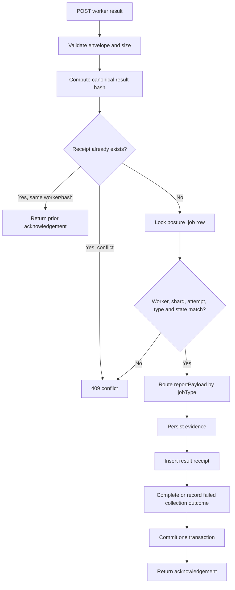

## 24. ISE integration design

### 23.1 ISE integration surfaces

The codebase has more than one ISE interaction and these should not be collapsed into a single conceptual API:

1. **Session monitoring:** `IseSessionClient` and `IseSessionWatcher` retrieve active-session information, detect connect/disconnect changes, batch-persist session events and feed reconnect-triggered job scheduling.
2. **ISE feed:** `IseFeedController` and `IseFeedService` expose a filtered endpoint posture feed for ISE to pull. `SharingRuleService` manages versioned scopes: `NONE`, `CONNECTED` and `CONNECTED_NON_COMPLIANT`.
3. **ISE enforcement and sharing actions:** `IseActionService` and `IseTransport` / `ErsIseTransport` perform supported operations and record action audit state.
4. **Durable ISE operations:** `IseOperationStore` and `IseOperationRecoveryScheduler` preserve in-flight operation state and reconcile operations that may have succeeded remotely even if the backend lost the response.
5. **ISE status:** `IseStatusController` and supporting status service expose reachability and last-success/error context.

### 23.2 ISE action durability

V32 creates `ise_action_operation` with states `PENDING`, `IN_PROGRESS`, `SUCCEEDED`, `FAILED` and `RECONCILIATION_REQUIRED`. The table stores an operation key, endpoint and MAC identity, action type, operator, optional policy/posture details, attempt count, retry time, result detail and operator resolution fields. An active-operation partial unique index prevents duplicate in-flight operations with the same operation key.

A recovery scheduler retries eligible pending operations and flags uncertain outcomes for reconciliation. This matters because a network timeout after sending an enforcement command does not prove the ISE rejected it. The application must distinguish “remote operation failed” from “remote outcome is unknown and requires reconciliation.”

### 23.3 ISE integration sequence

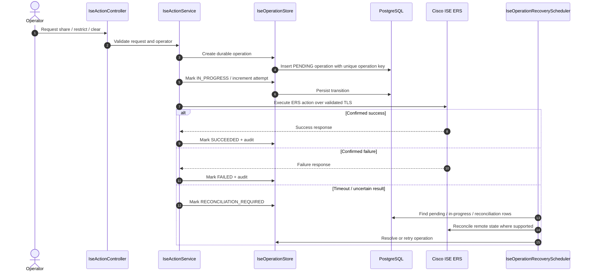

### 23.4 Connectivity boundary

The existence of ISE clients and transports in the source does not prove that the AWS environment currently has a live route, VPN, certificate trust chain, DNS resolution or firewall access to a Cisco ISE deployment. The HLD's no-assumed-connectivity statement remains in force. Before production ISE integration, validate network path, TLS trust, ISE API permissions, rate limits, paging behavior and the operational owner for reconciliation.

## 25. Data model and persistence design

### 24.1 Database conventions

- PostgreSQL is the system of record for application and worker lifecycle data.
- Flyway owns schema evolution. Do not hand-edit an already-applied migration; add the next migration instead.
- UUIDs are used for principal entities and cross-domain identifiers.
- Timestamps are stored as `TIMESTAMPTZ` and treated as UTC.
- Operational history that must survive parent-row retention uses deliberate foreign-key deletion behavior or historical identifiers without a cascading dependency.
- Concurrency invariants are enforced in PostgreSQL as well as in service code.

### 24.2 Logical entity relationship diagram

The diagram below is a logical relationship view assembled from the checked-in migrations and source associations. It intentionally omits some low-level columns and does not claim every optional foreign key is identical across all evidence tables.

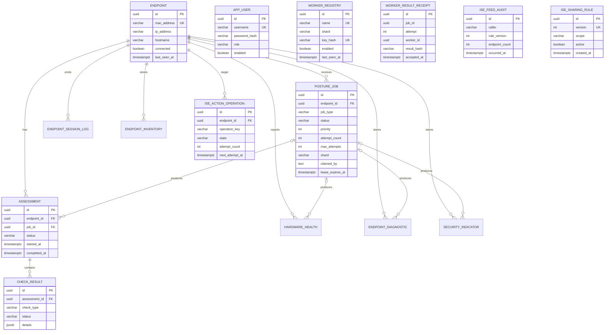

**ERD cautions:** The checked-in migrations establish the core table families and constraints. Some relationship lines above are logical associations rather than literal enforced foreign keys. For example, V29 deliberately stores historical `job_id` and `worker_id` identifiers in the result receipt without foreign keys so receipts survive job/worker retention. Likewise, do not add a foreign key to the diagram unless the migration actually declares it.

### 24.3 Migration catalogue

| Migration | Purpose |
|---|---|
| V1 | Users and roles |
| V2 | Endpoints |
| V3 | Posture jobs |
| V4 | Assessments and check results |
| V8 | Hardware health |
| V9 | Hardware failure tracking |
| V10 | Endpoint session log |
| V11 | ISE action audit |
| V12 | Endpoint inventory |
| V13 | Application policy |
| V14 | Login lockout state |
| V15 | Warranty records |
| V16 | Endpoint diagnostics |
| V17 | Endpoint security indicators |
| V18 | Job indexes |
| V19 | Job shard assignment |
| V20 | Latest-assessment and rollup support |
| V21 | Latest-hardware and recheck indexes |
| V22 | Trigram search indexes |
| V23 | Inventory pointer and retention indexes |
| V24 | ISE sharing rules |
| V25 | Worker lease ownership fields on posture jobs |
| V26 | Worker registry, enrollment tokens and worker auth events |
| V27 | Job recovery event history |
| V28 | Preserve job recovery audit history through retention |
| V29 | Durable worker result receipts |
| V30 | Prevent duplicate active posture jobs |
| V31 | Persist ISE disconnect grace state |
| V32 | Durable ISE action operations and reconciliation |

The checked-in `main` tree inspected for this LLD contains migrations V1-V4 and V8-V32. V5-V7 are not present in the current tree listing; do not infer their purpose. The local pagination candidate's V33 index migration is not included in this main-branch catalogue.

### 24.4 Key persistence invariants

| Invariant | Enforcement point |
|---|---|
| At most one active job of a given type per endpoint | Partial unique index plus `insertActiveIfAbsent` / enqueue logic |
| Worker keys are not stored in plaintext | Hash in `worker_registry`; key returned once on enrollment |
| Enrollment token can be redeemed once before expiry | Atomic conditional UPDATE in `WorkerRegistryService.enroll` |
| Worker can only claim jobs from its shard | Authenticated `WorkerPrincipal` shard passed to repository claim query |
| Old attempts cannot complete newer retries | `attempt_count` fencing token in conditional UPDATE |
| Expired leases cannot be renewed | Lease renewal predicate requires `lease_expires_at > now()` |
| One logical worker result receipt per job attempt | Unique `(job_id, attempt)` constraint |
| Duplicate result retry is idempotent | Result hash + worker identity + receipt lookup before and after row lock |
| ISE active operations are deduplicated | Unique partial index on active `operation_key` |
| Result evidence and accepted receipt are atomic | `WorkerResultService.submit` transaction |

## 26. Frontend low-level design

### 25.1 Frontend stack and directory layout

The frontend is a Next.js App Router application using React 19 and TypeScript. The inspected package manifest defines Vitest unit tests, a separate integration test config, ESLint, TypeScript checking and Prettier scripts.

| Path | Responsibility |
|---|---|
| `app/login/` | User sign-in route |
| `app/(dashboard)/` | Authenticated dashboard pages and route group |
| `components/layout/` | Shared dashboard shell/navigation |
| `components/dashboard/` | Dashboard visual components |
| `components/endpoints/` | Endpoint-focused components |
| `components/ui/` | Reusable UI primitives |
| `lib/api.ts` | Shared typed backend API client, request helper and core domain types |
| `lib/apiExtra.ts` | Additional APIs for inventory and ISE feed/sharing rule |
| `lib/auth.ts`, `lib/session.ts` | Client auth/session state |
| `lib/permissions.ts` | Frontend role/permission checks |
| `lib/useCachedFetch.ts` | Cached fetch hook |
| `lib/usePagination.ts` | Pagination state hook |
| `lib/usePolling.ts` | Polling hook |
| `lib/IseStatusContext.tsx` | Shared ISE status context |
| `lib/csv.ts`, `lib/inventory.ts` | CSV and inventory helpers |

### 25.2 Dashboard pages

The checked-in dashboard route group contains pages for overview, endpoints and endpoint detail, applications, ports, hardware, jobs, audit, compliance, ISE actions, ISE feed, policies, system health, users and warranty. A login page is separate from the dashboard route group.

### 25.3 API request lifecycle

`frontend/lib/api.ts` centralizes calls through `request<T>()`. It reads the bearer token from `sessionStorage`, sets `Accept: application/json`, adds JSON content type when appropriate, and sends the request. Network failures become `ApiError` with status 0. A 401 clears the token and current user and redirects the browser to `/login`, except on the login endpoint where a login-specific message is returned. Non-2xx responses are converted to `ApiError`, preferring a JSON `message` or `error` field.

The frontend defines TypeScript interfaces for endpoints, posture assessments, check results, hardware health, jobs, audit events, ISE status, sessions, dashboard summaries, policies, users, diagnostics, security findings, warranty and paginated response envelopes. These are compile-time contracts; the backend remains authoritative for validation and authorization.

### 25.4 Frontend data-flow diagram

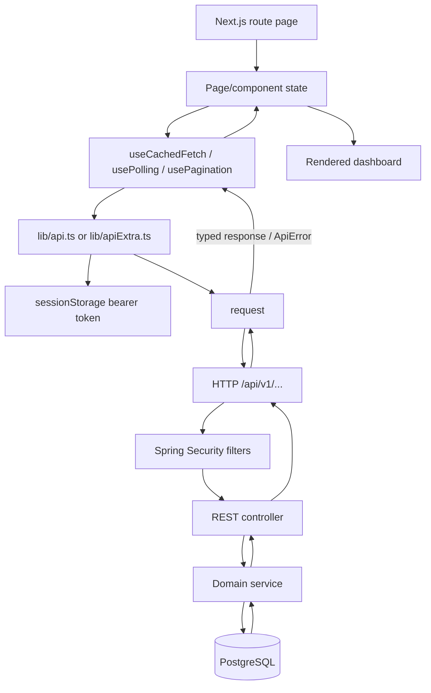

### 25.5 Frontend/backend contract rules

- Keep TypeScript types aligned with Java response DTOs and controller records.
- Treat 204 as an absent optional resource where the endpoint contract specifies it.
- Do not assume all historical list routes are paginated. Preserve legacy list shapes while using explicit `/page` endpoints where present.
- Bound query sizes and avoid requesting full fleet histories in a single browser call.
- Centralize auth and error handling in the shared request helper rather than duplicating token logic in pages.
- Keep role checks in the UI for navigation/experience, but never rely on frontend checks as the security boundary.
- When adding a backend endpoint, update the typed API client, relevant tests and the consuming page/component together.

## 27. Observability, health and operational signals

### 26.1 Health surfaces

- `/actuator/health` and health subpaths are configured for health probes.
- `/actuator/prometheus` is restricted to ADMIN in the inspected security configuration.
- `/api/v1/system/health` returns aggregate application status, database reachability, ISE reachability/last success/error, queue state, worker execution mode and warnings.
- `JobQueueMetrics` and worker outbox statistics expose execution and delivery signals.

### 26.2 Signals to monitor

| Area | Signals |
|---|---|
| API | Request rate, p50/p95/p99 latency, 4xx/5xx, authentication failures, throttling |
| PostgreSQL | Connections, transaction latency, lock waits, slow queries, storage, replication/backup health |
| Job queue | QUEUED/RUNNING/COMPLETE/FAILED counts, oldest queued age, attempts, retry rate, lease expiry and recovery count |
| Workers | ACTIVE/STALE/REVOKED counts, heartbeat age, claims per worker/shard, execution duration, failure rate |
| Result delivery | SQLite pending count, oldest unresolved result, retry count, permanent failures, outbox bytes, last backend success |
| ISE | Reachability, last success, API errors, operation age/state, reconciliation-required count |
| Evidence | Collection success/partial/failure counts by job type, assessment age, inventory retention and ingestion volume |

### 26.3 Operational alert candidates

- Oldest queued job age breaches the service objective.
- A worker shard has no ACTIVE workers while queued jobs are accumulating.
- A worker remains STALE beyond the operational grace window.
- Expired lease recovery or retry rates rise unexpectedly.
- Worker result outbox pending age or permanent failures exceed threshold.
- PostgreSQL connection saturation, lock contention or elevated p95 query latency.
- ISE becomes unreachable or durable operations remain in `RECONCILIATION_REQUIRED`.
- Evidence ingestion failures or invalid result envelope rates spike.

## 28. Deployment and infrastructure LLD

### 27.1 Current repository assets vs target architecture

| Concern | Checked-in source evidence | LLD interpretation |
|---|---|---|
| Backend container | Backend Docker/build assets and Linux profile | Package Spring API as Linux image |
| Frontend container | `frontend/Dockerfile` | Build Next.js separately from backend |
| Local orchestration | `docker-compose.yml` | Local development/test topology, not proof of production topology |
| Terraform network | `terraform/modules/network` | Network foundation is checked in |
| Terraform PostgreSQL | `terraform/modules/postgres` | Managed PostgreSQL foundation is checked in |
| ECS Fargate service | No ECS module in the inspected Terraform tree | HLD target decision; implementation remains to be added/verified |
| ECR repositories | No ECR module in the inspected Terraform tree | Required target for immutable backend/frontend image publication; implementation remains to be added/verified |
| ALB and ACM | HLD target components | Confirm actual Terraform resources before claiming deployed |
| Windows service | `deploy/` scripts, WinSW XML and worker runtime | Worker service packaging/installation assets are present |
| CloudWatch | HLD target component | Confirm log groups, metrics and alarms in deploy configuration before claiming deployed |
| Secrets Manager/KMS | HLD security recommendation | Confirm Terraform and runtime secret wiring before claiming deployed |
| GitHub Actions | `.github/workflows/ci.yml`, `.github/workflows/terraform.yml` | CI and Terraform workflow definitions exist; verify their current jobs and environment gates before production use |

### 27.2 Target runtime placement

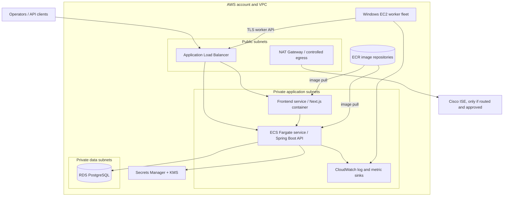

The diagram is the target deployment pattern, not proof that each resource exists in Terraform or AWS today. The worker-to-API route should be private/internal where the network design supports it. Do not expose PostgreSQL publicly. Keep the backend tasks without public IPs. Separate the public user ingress from the worker ingress if the threat model and routing requirements call for separate ALBs.

### 27.3 Image and release flow

```mermaid
flowchart LR
  G[Git push / pull request] --> CI[GitHub Actions CI]
  CI --> TEST[Backend tests + frontend checks + worker tests]
  TEST --> BUILD[Build backend and frontend images]
  BUILD --> ECR[(Amazon ECR)]
  ECR --> TASK[ECS task definition revision]
  TASK --> ECS[ECS Fargate service rollout]
  G --> WBUILD[Build worker shaded JAR / deployment bundle]
  WBUILD --> WREL[Versioned worker release artifact]
  WREL --> WINS[Controlled Windows worker deployment]
  ECS --> HEALTH[Health and smoke checks]
  WINS --> WH[Worker heartbeat and claim validation]
  HEALTH --> OBS[CloudWatch / release status]
  WH --> OBS
```

Build backend, frontend and worker runtime as independently versioned artifacts. A backend rollout must not require rebuilding the Windows worker unless the worker API/result schema changes. A worker rollout must preserve backward compatibility with the backend result schema version and endpoint contracts. Use image digests or immutable tags for deploy reproducibility.

## 29. Performance, scale and capacity design

The design separates API capacity from endpoint-check execution capacity. Backend Fargate tasks should scale based on API request load, CPU/memory, latency and connection pool behavior. Windows worker count and concurrency should scale based on queue depth/age, execution duration, endpoint reachability and worker capacity.

The previously established planning target is up to 50,000 simulated endpoints. This is a test target, not a proven production capacity result. Validate the following before sizing production resources:

- Job enqueue throughput and duplicate prevention under concurrent requests.
- Claim throughput across many workers and shards using PostgreSQL `SKIP LOCKED`.
- Result payload size, worker body limits and PostgreSQL transaction duration.
- Database connection pool sizing against Fargate task count and worker polling rate.
- Dashboard pagination and expensive inventory JSONB queries.
- ISE feed paging and request volume.
- SQLite outbox disk growth during a prolonged backend outage.
- Worker fleet throughput by job type and actual PowerShell execution time.

Do not infer that 50,000 endpoints can all be checked simultaneously. Capacity depends on worker concurrency, endpoint availability, collection time, ISE rate limits, result size and database write capacity. Use staged load tests and report throughput plus p95/p99 completion latency.

## 30. Test architecture and verification map

| Test layer | Main target | Evidence / tools |
|---|---|---|
| Backend unit tests | Services, validators, scorers, policies, state transitions | JUnit / Spring Boot Test |
| Backend MVC/security tests | Route contracts, role access, filters and response status | MockMvc, Spring Security Test |
| Backend PostgreSQL integration tests | Native SQL, Flyway, row locks, `SKIP LOCKED`, transactions, constraints | Testcontainers PostgreSQL 16 |
| Worker unit tests | Config, lifecycle, credential store, parsing, execution and outbox state | JUnit 5 |
| Worker API contract tests | Enrollment, heartbeat, claim, lease, result and error handling | Worker test HTTP server / client tests |
| Windows-specific execution tests | PowerShell process invocation and real agent output contract | Windows-targeted tests; do not assume Linux CI exercises these |
| Frontend unit tests | API helper, permissions, sessions, CSV, pagination and hooks | Vitest |
| Frontend integration tests | Backend API contract and user-facing data flows | Vitest integration config |
| Infrastructure validation | Terraform formatting, validation and plan review | Terraform workflow |
| Deployment smoke tests | Backend health, worker service install/start, heartbeat and job round-trip | `deploy/Test-Deployment.ps1` plus environment smoke tests |

The 18 November local integration audit reported `mvn -f backend/pom.xml verify` passing 595 backend tests with V33 applied in PostgreSQL 16 Testcontainers in the integration worktree. That result is specific to that worktree/source state and must not be represented as a fresh verification of the checked-in `main` commit. The same audit identified pending work around query-plan validation, frontend build/tests after the pagination edits, and selective integration. Re-run the full matrix on the exact release commit before production deployment.

## 31. Known design gaps and decisions requiring confirmation

1. **Current source vs local worktrees:** The repository contains multiple isolated worktrees and uncommitted work. This LLD uses the checked-in `main` commit listed at the top. Reconcile local work only through reviewed, selective integration. Preserve all unrelated worktree changes.
2. **Pagination candidate:** V33 and the broad pagination UI/API expansion are local integration work in the audit, not part of the inspected main tree. Validate legacy array completeness, preview authorization, query plans and frontend tests before adoption.
3. **ECS/ECR implementation:** Fargate and ECR are the selected target design, but the inspected Terraform tree only establishes network and PostgreSQL modules. ECS, ECR, ALB, ACM, CloudWatch, Secrets Manager and KMS resources need implementation or independent deployment evidence.
4. **ISE reachability:** The code has ISE clients and transports, but live AWS-to-ISE connectivity is environment-dependent and not assumed. Network, TLS, credentials and API permissions remain deployment prerequisites.
5. **Worker deployment topology:** Worker packaging/service scripts exist. Confirm the exact production Windows AMI, service identity, PowerShell execution policy, local outbox path, disk monitoring, upgrade/rollback and log forwarding.
6. **Worker result schema evolution:** The current result envelope supports schema version 1. Define compatibility and deprecation policy before introducing a new schema version.
7. **Outbox retention and operator tooling:** Confirm retention/cleanup rules for delivered and permanent-failure SQLite rows, secure export/replay procedures and disk-full handling.
8. **ISE reconciliation semantics:** Confirm which remote ISE operations can be queried to determine final state after an uncertain response, and define the operator workflow when reconciliation cannot decide.
9. **Tenant isolation:** The inspected source uses role-based access and fixed ISE feed scopes. No tenant isolation model was established in the reviewed repository context; do not claim tenant-level isolation without a dedicated design and tests.
10. **Production API catalogue:** Generate and review the OpenAPI document from the exact release build. This table is a selected route map, not a complete contract specification.

## 32. Implementation reference map

Use this map when changing the system:

| Change requested | Start with | Then inspect |
|---|---|---|
| Add endpoint attribute | `endpoint/Endpoint` | migration, DTO, service, controller, frontend types/pages |
| Add a posture check | `job/spec/`, `JobSpecFactory`, `PostureIngestService` | worker `JobSpecParser`, `PowerShellJobHandler`, report DTO, result service, tests |
| Add a job type | `JobType`, `JobService`, `JobSpecFactory` | worker parser/handler, `WorkerResultService` dispatch, API types, UI |
| Change worker authentication | `WorkerAuthFilter`, `WorkerRegistryService`, `SecurityConfig` | `WorkerApiClient`, DPAPI credential store, rate-limit and auth tests |
| Change claim or lease logic | `WorkerJobService`, `JobService`, `PostureJobRepository` | V25/V26, concurrency tests, worker lifecycle/dispatcher |
| Change result delivery | `WorkerResultService`, result receipt repository | V29, worker `SqliteJobResultHandoff`, `ResultDispatcher`, schema contract tests |
| Add new evidence type | matching ingest service and report DTO | `WorkerResultService` routing, migration/entity/repository, frontend types and detail page |
| Change ISE action | `IseActionService`, `IseTransport`, `IseOperationStore` | V32, recovery scheduler, audit state, TLS config and integration tests |
| Change ISE feed visibility | `SharingRuleService`, `IseFeedService`, `IseFeedAuthFilter` | V24, ADMIN authorization, feed tests and ISE consumer contract |
| Change UI auth/session | `frontend/lib/api.ts`, `auth.ts`, `session.ts` | backend `SecurityConfig`, JWT filter, permission tests |
| Add dashboard page | `frontend/app/(dashboard)/` | shared API client, hooks, permissions, navigation and tests |
| Change AWS infrastructure | `terraform/` modules and root | CI Terraform workflow, state backend, plan review, HLD target architecture |

## 33. Mermaid diagram index

The document now includes both HLD diagrams and these LLD diagrams:

1. Component dependency diagram.
2. Backend request/service/repository interaction.
3. Job enqueue, claim, execute and result sequence.
4. Job lifecycle state machine.
5. Worker startup, execution and durable result delivery sequence.
6. Security authentication and authorization sequence.
7. Worker result validation/idempotency flow.
8. ISE durable action and reconciliation sequence.
9. Logical database ER diagram.
10. Frontend API/data flow.
11. Target deployment placement.
12. CI/CD and release flow.

---

## Document maintenance

- Treat this Markdown file as the editable source of truth for the combined HLD + LLD.
- Update the repository commit, migration catalogue, API route map and implementation status whenever the baseline changes.
- Keep target-state diagrams separate from deployed-resource claims.
- For code-level changes, update the relevant LLD section and Mermaid diagram in the same pull request as the implementation where practical.
- Regenerate the DOCX from this Markdown only when a shareable Word deliverable is needed.